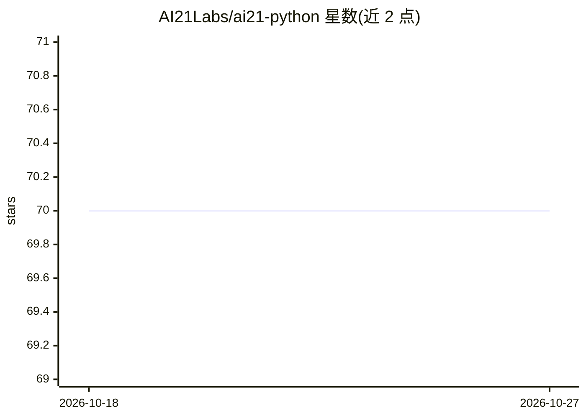

# AI21Labs/ai21-python

⭐ 70 · Python · Apache-2.0 · 推送 2026-01-28 · [GitHub](https://github.com/AI21Labs/ai21-python) · [官网](https://docs.ai21.com/docs/sdk) · 组织维护

**AI21 Labs 官方 Python SDK：接入 Jamba 模型与 AWS/Azure/GCP**

AI21 Labs 官方维护的 Python SDK，通过 AI21Client/AsyncAI21Client 调用 AI21 Studio API，覆盖 Chat、Completion、Chat Completion、流式输出、Maestro 规划编排、Agents（Beta）、Conversational RAG（Beta）与文件上传。提供专门客户端接入 AWS Bedrock、SageMaker、Azure AI Studio 与 Vertex AI（GCP），AWS 接入需额外安装 ai21[AWS]（含 boto3）。API key、超时、重试次数等通过环境变量配置。

## 筛选速览

| 维度 | 判定 | 备注 |
|---|---|---|
| AI 角色 | `ai-ecosystem` | LLM/agent 周边工具 |
| 许可风险 | `permissive` | Apache-2.0 |
| 部署形态 | `library` | 以包/库形式分发 |
| 模型依赖 | locked-api |  |
| 硬件要求 | — | 无带数字的原话,不猜 |
| 安装摩擦 | `low` | 无编译、无系统依赖或容器化 |
| 成熟度 | — | 结构信号不足 |

## 能力要点

- 同步/异步双客户端，覆盖 Chat/Completion/流式输出
- Maestro 编排、Agents 与 Conversational RAG（Beta）能力接入
- AWS Bedrock/SageMaker、Azure、Vertex AI 专属客户端

## 适用场景

- 在 Python 应用中调用 AI21 Jamba 系列模型
- 通过 AWS/Azure/GCP 托管端点使用 AI21 模型
- 构建基于 AI21 Agents 或 Conversational RAG 的应用

## 场景标签

`模型网关` · 领域:Agent 开发

## 证据(README 行号)

> L34: from ai21 import AI21Client
> L199: AI21 Library provides convenient ways to interact with two AWS clients for use with AWS Bedrock and AWS SageMaker.

## 星数曲线

2026-10-18 70 → 2026-10-27 70（+0）

---
*卡片 v1 · prompt 1.4 · 生成 2026-10-24 · 置信度 high · 依据 README sha `c7588d0712de` · [字段定义](../../DATASET.md)*
