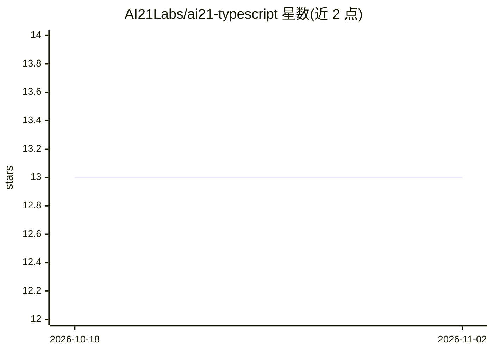

# AI21Labs/ai21-typescript

⭐ 13 · TypeScript · Apache-2.0 · 推送 2025-12-18 · [GitHub](https://github.com/AI21Labs/ai21-typescript) · 组织维护

**面向 AI21 API 的 TypeScript 客户端 SDK**

AI21 Labs 官方的 TypeScript/JavaScript 库，封装 AI21 API 请求：Chat 补全（含流式响应）、Beta 阶段的 Maestro 编排平台接口（支持 createAndPoll 轮询、结构化输入）、Conversational RAG（基于上传文件问答）与 Library 文件管理。运行于 Node.js >=18，浏览器环境需显式设置 dangerouslyAllowBrowser 并注意 API key 暴露风险。通过 npm/yarn 安装，Apache-2.0 许可。

## 筛选速览

| 维度 | 判定 | 备注 |
|---|---|---|
| AI 角色 | `ai-ecosystem` | LLM/agent 周边工具 |
| 许可风险 | `permissive` | Apache-2.0 |
| 部署形态 | `library` | 以包/库形式分发 |
| 模型依赖 | — | README 未给出锁定关系 |
| 硬件要求 | — | 无带数字的原话,不猜 |
| 安装摩擦 | `low` | 无编译、无系统依赖或容器化 |
| 成熟度 | — | 结构信号不足 |

## 能力要点

- Chat 补全 API 封装，支持流式响应与异步迭代器
- Maestro（Beta）编排接口，含 createAndPoll 自动等待完成
- Conversational RAG（Beta）基于上传文件问答
- Library Files 文件管理 API 接入

## 适用场景

- 在 Node.js 或浏览器应用中调用 AI21 模型
- 通过 SDK 使用 Maestro 工作流与 RAG 问答能力
- 管理用于 RAG 的上传文件库

## 场景标签

`RAG` · 领域:知识与检索

## 证据(README 行号)

> L10: The AI21 API Client is a TypeScript library that provides a convenient interface for interacting with the AI21 API.
> L63: The `AI21` class provides a `chat` property that gives you access to the Chat API. You can use this to generate tex

## 星数曲线

2026-10-18 13 → 2026-11-02 13（+0）

---
*卡片 v1 · prompt 1.4 · 生成 2026-10-31 · 置信度 high · 依据 README sha `e5a50ccc4d55` · [字段定义](../../DATASET.md)*
