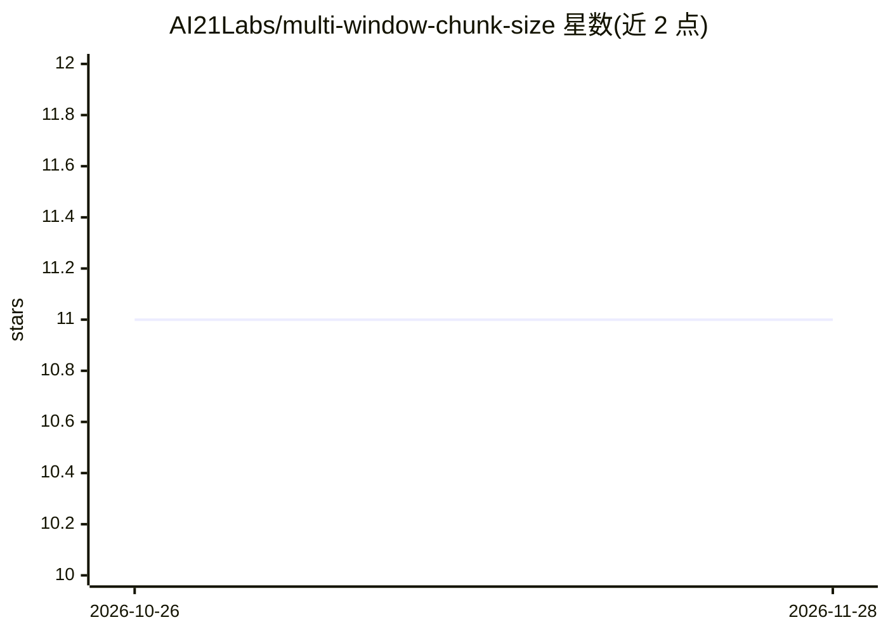

# AI21Labs/multi-window-chunk-size

⭐ 11 · Jupyter Notebook · 推送 2026-01-28 · [GitHub](https://github.com/AI21Labs/multi-window-chunk-size) · 组织维护

**演示 RAG 多尺度分块检索与 RRF 聚合的示例仓库**

AI21 Labs 发布的示例仓库，通过 Jupyter notebook 演示多尺度检索方法：将同一语料按 100/200/500 tokens 三种分块大小分别建立向量索引，推理时并行查询，再用倒数排名融合（RRF）聚合排序。附带 Seinfeld 剧集问答数据集（174 个 markdown 文档与带 gold document 的 trivia 问题），并给出三个查询对应不同最优分块大小的实例。运行依赖 OpenAI API key。

## 筛选速览

| 维度 | 判定 | 备注 |
|---|---|---|
| AI 角色 | `ai-knowledge` | 知识聚合/清单类 |
| 许可风险 | `none` | — |
| 部署形态 | `library` | 以包/库形式分发 |
| 模型依赖 | — | README 未给出锁定关系 |
| 硬件要求 | — | 无带数字的原话,不猜 |
| 安装摩擦 | `low` | 无编译、无系统依赖或容器化 |
| 成熟度 | — | 结构信号不足 |

## 能力要点

- 同一语料按 100/200/500 tokens 多分块索引并并行查询
- 使用 Reciprocal Rank Fusion (RRF) 聚合多路检索结果
- 附带 Seinfeld trivia 问答基准数据集（含 gold documents）
- 无需重训练或查询分类，仅并行检索与排名聚合

## 适用场景

- 为 RAG 系统实验不同 chunk size 的检索效果
- 学习 RRF 多路排名聚合的实现方式
- 用自己的语料构建多尺度向量索引做检索评测

## 场景标签

`RAG` `模型评测` · 领域:评测与运维

## 证据(README 行号)

> L3: This repository demonstrates a multi-scale retrieval approach for RAG (Retrieval-Augmented Generation) systems, show
> L17: ├── multi-window-chunk-size.ipynb   # Main notebook demonstrating the approach

## 星数曲线

2026-10-26 11 → 2026-11-28 11（+0）

---
*卡片 v1 · prompt 1.4 · 生成 2026-11-19 · 置信度 mid · 依据 README sha `d237304d2aad` · [字段定义](../../DATASET.md)*
