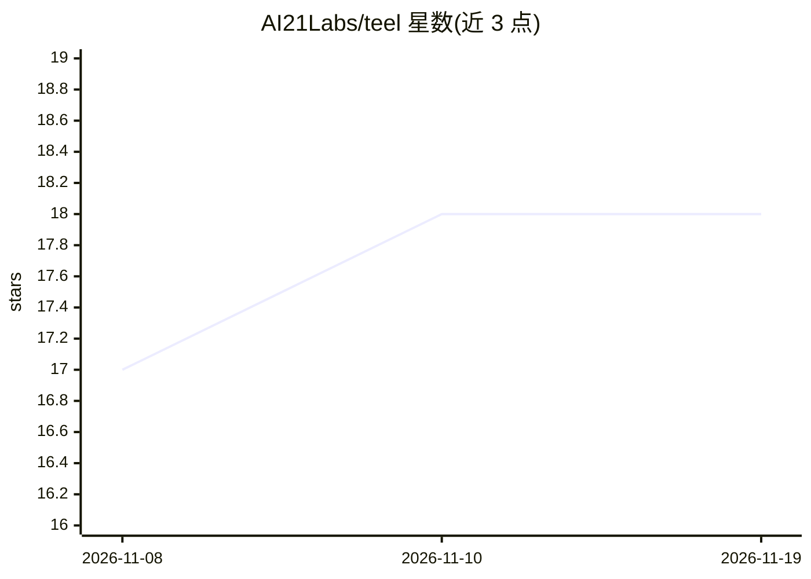

# AI21Labs/teel

⭐ 18 · Python · 推送 2026-11-05 · [GitHub](https://github.com/AI21Labs/teel) · 组织维护

**通过前瞻投机并行加速同步 Python 的字节码库**

AI21Labs 开发的 Python 执行优化库：通过影子字节码解释器复制执行状态，对标记为 @cacheable 的纯函数做前瞻搜索，提前提交到 ThreadPoolExecutor 并行执行，从而缩短同步代码的端到端耗时。API 为三个装饰器（@cacheable/@jit/@inline）加一个 Teel 上下文管理器，支持输出 Chrome trace 时间线。限制：要求 Python 3.12.13、被并行函数须纯净幂等、CPU 密集且受 GIL 约束的函数无效，自述为 Proof-of-Concept。示例为 tree-of-thoughts-llm 与 LangChain Deep Agents 加速。

## 筛选速览

| 维度 | 判定 | 备注 |
|---|---|---|
| AI 角色 | `ai-ecosystem` | LLM/agent 周边工具 |
| 许可风险 | `none` | — |
| 部署形态 | `None` |  |
| 模型依赖 | — | README 未给出锁定关系 |
| 硬件要求 | — | 无带数字的原话,不猜 |
| 安装摩擦 | `low` | 无编译、无系统依赖或容器化 |
| 成熟度 | `idea` | |

## 能力要点

- 影子字节码解释器实现前瞻投机执行
- @cacheable/@jit/@inline 三装饰器与上下文管理器的薄 API
- 按函数与 json.dumps 参数去重的调用缓存
- 输出 Chrome trace-event 时间线可在 Perfetto 查看

## 适用场景

- 加速 IO 密集的 LLM/Agent 同步代码而无需改写成 async
- 对既有同步流水线（如 tree-of-thoughts）外挂装饰器获得并行加速
- 通过 trace 时间线分析哪些调用被提前并行执行

## 场景标签

 · 领域:Python 运行时/性能工具

## 证据(README 行号)

> L5: Since LLMs and Agents, a big portion of production code became IO-bound.
> L141: We took Princeton's `tree-of-thoughts-llm`, unmodified, and ran several samples of the "Game of 24" dataset with G
> L151: We took LangChain's Deep Agents (specifically the Deep Agents Code CLI, or `dcode`) for a spin.

## 星数曲线

2026-11-08 17 → 2026-11-19 18（+1）

---
*卡片 v1 · prompt 1.4 · 生成 2026-11-18 · 置信度 high · 依据 README sha `d5ffd7736432` · [字段定义](../../DATASET.md)*
