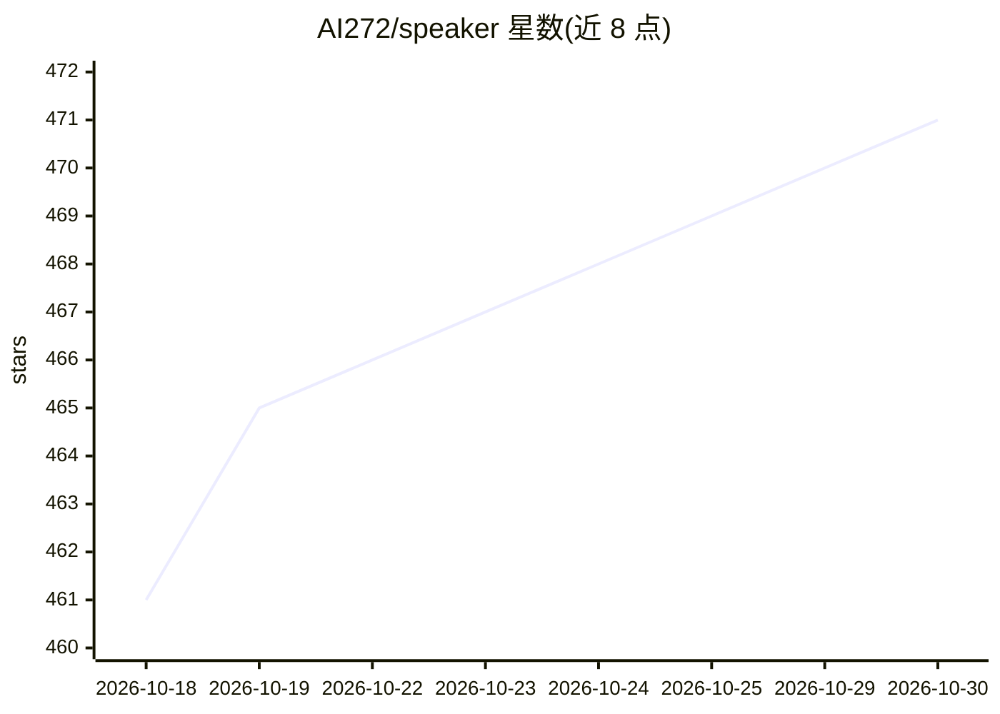

# AI272/speaker

⭐ 471 · Python · 推送 2026-06-23 · [GitHub](https://github.com/AI272/speaker) · 个人维护 · 中文 README

**面向学术演讲的 Codex/Claude Code 技能：从真实 PPTX 生成逐页讲稿**

名为 ppt-speech-writer 的技能包（speaker-v8.skill），供 Codex 客户端与 Claude Code 使用：读取 .pptx，结合文本抽取、OOXML 结构解析、幻灯片渲染为 PNG、区域 OCR 与视觉审查，构建逐页可见元素清单，按语速模型（英文约110 wpm、中文约165字/分钟）分配每页字数预算，生成排练用展示文档与干净版讲稿并注入 PowerPoint 备注栏。依赖缺失时降级并报告局限；复杂视觉内容需视觉审查，不确定元素须标注而非编造。

## 筛选速览

| 维度 | 判定 | 备注 |
|---|---|---|
| AI 角色 | `ai-native` | 本体是模型或模型工具 |
| 许可风险 | `none` | — |
| 部署形态 | `None` |  |
| 模型依赖 | — | README 未给出锁定关系 |
| 硬件要求 | — | 无带数字的原话,不猜 |
| 安装摩擦 | `low` | 无编译、无系统依赖或容器化 |
| 成熟度 | — | 结构信号不足 |

## 能力要点

- 多源证据链：XML 解析 + 幻灯片渲染 + 区域 OCR + 视觉审查
- 逐页字数预算与停顿感知的语速模型，按总时长控制讲稿长度
- 输出双版本：排练用 .docx/.md 文档 + 注入 PPT 备注栏的干净版讲稿
- 兼容 Codex 技能导入流程，附 Claude Code 项目技能调用方式

## 适用场景

- 为学术会议报告或论文答辩准备逐页演讲稿
- 处理含图表、截图、SmartArt 等复杂视觉内容的幻灯片讲稿
- 生成带幻灯片标签、过渡、术语表和时间表的排练文档

## 场景标签

`AI 写作` · 领域:内容生成

## 证据(README 行号)

> L7: `speaker` is a Codex skill project for academic presentations. It reads a real `.pptx`, combines text extraction, PP
> L62: |Notes injection|Writes clean speaker notes into the PowerPoint notes pane|
> L128: |`<deck-stem>-with-notes.pptx`|PowerPoint file with speaker notes injected|

## 星数曲线

2026-10-18 461 → 2026-10-30 471（+10）

---
*卡片 v1 · prompt 1.4 · 生成 2026-10-21 · 置信度 high · 依据 README sha `32c1db11a9a2` · [字段定义](../../DATASET.md)*
