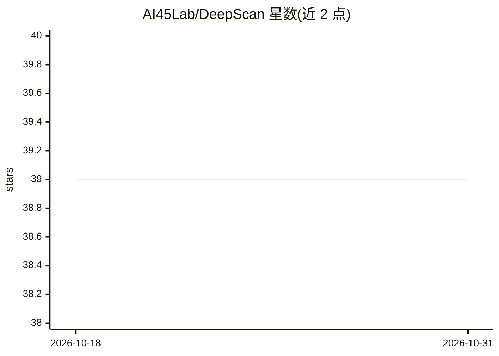

# AI45Lab/DeepScan

⭐ 39 · Python · NOASSERTION · 推送 2026-03-02 · [GitHub](https://github.com/AI45Lab/DeepScan) · [官网](https://ai45.shlab.org.cn/deepscan) · 组织维护 · 中文 README

**面向 LLM/MLLM 的诊断评测框架，研究者用**

提供"注册→配置→执行→汇总"工作流的模型诊断框架：内置模型注册表预注册 Qwen、Llama、Mistral、Gemma、GLM、InternLM、InternVL 等家族，统一 generate/chat 接口，数据集注册与 YAML/JSON 配置加载。内置 TELLME、X-Boundary、MI-Peaks、SPIN 四个诊断评测器，分别做概念解耦度量、安全边界几何分析、推理互信息追踪与安全目标冲突分析。支持 CLI 免代码运行与插件式扩展自定义评测器与汇总器。以 Python 包 pip 安装，MIT 许可，联系邮箱为 pjlab.org.cn 域名。

## 筛选速览

| 维度 | 判定 | 备注 |
|---|---|---|
| AI 角色 | `ai-ecosystem` | LLM/agent 周边工具 |
| 许可风险 | `none` | NOASSERTION |
| 部署形态 | `library` | 以包/库形式分发 |
| 模型依赖 | — | README 未给出锁定关系 |
| 硬件要求 | — | 无带数字的原话,不猜 |
| 安装摩擦 | `medium` | 含编译或系统依赖之一 |
| 成熟度 | — | 结构信号不足 |

## 能力要点

- 内置 TELLME/X-Boundary/MI-Peaks/SPIN 四个诊断评测器
- 预注册 Qwen/Llama/GLM/InternVL 等模型家族与统一 Runner 接口
- Register→Configure→Execute→Summarize 流程，CLI 可免代码运行
- 插件架构可注册自定义 Evaluator 与 Summarizer

## 适用场景

- 对开源 LLM/MLLM 做安全性与表征空间诊断
- 用统一配置批量跑多个评测器生成诊断报告
- 扩展自定义诊断指标接入现有管线

## 场景标签

`模型评测` · 领域:评测与运维

## 证据(README 行号)

> L9: A flexible and extensible framework for diagnosing Large Language Models (LLMs) and Multimodal Large Language Models
> L22: - **🔍 Extensible Evaluators**: Built-in diagnostic evaluators:
> L29: - **💻 CLI Support**: Run evaluations directly from command line without writing code

## 星数曲线

2026-10-18 39 → 2026-10-31 39（+0）

---
*卡片 v1 · prompt 1.4 · 生成 2026-10-25 · 置信度 high · 依据 README sha `158b219e3e46` · [字段定义](../../DATASET.md)*
