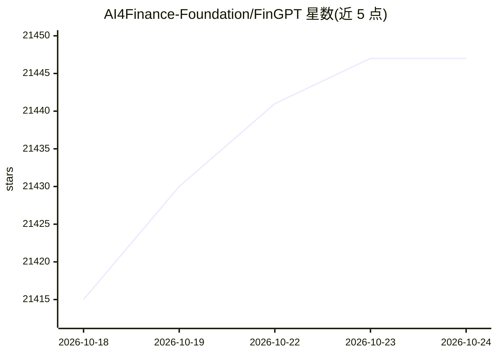

# AI4Finance-Foundation/FinGPT

⭐ 21,456 · Jupyter Notebook · MIT · 推送 2026-09-23 · [GitHub](https://github.com/AI4Finance-Foundation/FinGPT) · [官网](https://fingpt.io) · 组织维护 · 中文 README

**面向金融场景的开源大语言模型项目与微调框架**

由 AI4Finance Foundation 维护的金融大语言模型项目：在 HuggingFace 发布基于 Llama2/ChatGLM2/Falcon/Bloom/MPT/Qwen 等开源底座、以 LoRA 微调的金融模型，任务覆盖情感分析、关系抽取、NER、金融问答与股价走势预测（FinGPT-Forecaster）。配套指令微调数据集、基准测试与五层架构（数据源/数据工程/LLM/任务/应用）。可用云 API（OpenAI）推理或本地 GPU 运行，单张 RTX 3090 可完成 8bit/QLoRA 微调。

## 筛选速览

| 维度 | 判定 | 备注 |
|---|---|---|
| AI 角色 | `ai-native` | 本体是模型或模型工具 |
| 许可风险 | `permissive` | MIT |
| 部署形态 | `library` | 以包/库形式分发 |
| 模型依赖 | — | README 未给出锁定关系 |
| 硬件要求 | `cpu-ok` | |
| 安装摩擦 | `low` | 无编译、无系统依赖或容器化 |
| 成熟度 | — | 结构信号不足 |

## 动量与使用信号

- 维护:`active` — 距上次 push 25.3 天,年发版 1,35 位贡献者
- 涨星:近 1 天 **+5**(自 20261016 起算)
- 安装:github 包 `release-assets` 月下载无数据
- 平台:— · 协议:OPENAI-API

## 能力要点

- 发布多任务金融 LLM 与情感分析模型至 HuggingFace
- LoRA/QLoRA 轻量微调，单张 RTX 3090 即可训练
- FinGPT-Forecaster 提供股票下周走势预测的 HuggingFace Space 演示
- 提供指令微调数据集与 FinGPT-Benchmark 基准

## 适用场景

- 对财经新闻和推文做金融情感分析
- 微调出适配特定市场的金融 LLM
- 输入 ticker 生成公司分析与下周股价走势预测
- 运行金融 NLP 任务（NER、关系抽取、金融问答）

## 场景标签

`金融量化` `微调` `模型评测` · 领域:评测与运维

## 证据(README 行号)

> L22: FinGPT is an open-source financial large language model project developed and maintained by the AI4Finance Foundati
> L109:  * What's new: **Best trainable and inferable FinGPT for sentiment analysis on a single RTX 3090, which is even be

## 星数曲线

2026-10-18 21,415 → 2026-10-24 21,447（+32）

---
*卡片 v1 · prompt 1.4 · 生成 2026-10-18 · 置信度 high · 依据 README sha `e17b5ec8375e` · [字段定义](../../DATASET.md)*
