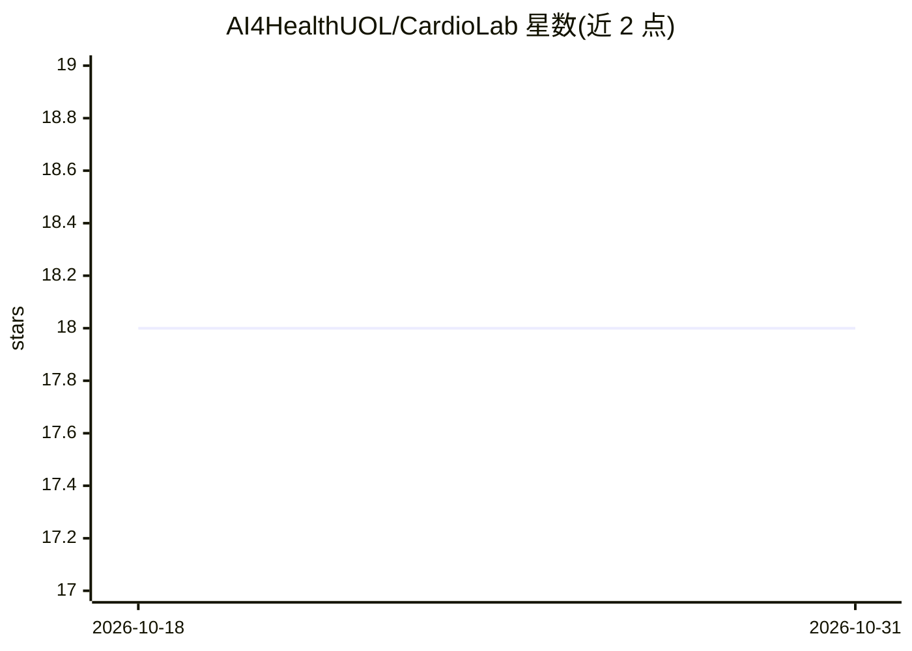

# AI4HealthUOL/CardioLab

⭐ 18 · Python · MIT · 推送 2026-01-12 · [GitHub](https://github.com/AI4HealthUOL/CardioLab) · 组织维护

**从 ECG 信号估计与监测化验异常的深度学习框架**

研究型机器学习与深度学习框架，用 ECG 波形、人口学信息、生物特征与生命体征做二分类，预测当前的异常化验值，并支持在未来 30/60/120 分钟时间窗内监测异常出现。框架内容在两篇 arXiv 论文中提出：CinC 2024 会议论文使用 ECG 表格特征，第二篇使用原始 ECG 波形的多模态方法。README 仅含项目描述、临床设定说明与文献引用，未给出安装或运行方式。

## 筛选速览

| 维度 | 判定 | 备注 |
|---|---|---|
| AI 角色 | `ai-native` | 本体是模型或模型工具 |
| 许可风险 | `permissive` | MIT |
| 部署形态 | `None` |  |
| 模型依赖 | — | README 未给出锁定关系 |
| 硬件要求 | — | 无带数字的原话,不猜 |
| 安装摩擦 | `low` | 无编译、无系统依赖或容器化 |
| 成熟度 | — | 结构信号不足 |

## 能力要点

- 基于 ECG 波形的多模态输入预测异常化验值
- 支持估计（当前）与监测（未来 30/60/120 分钟）两类任务
- 配套两篇 arXiv 论文（其一被 CinC 2024 接收）

## 适用场景

- 研究人员复现 ECG 化验值估计论文方法
- 在临床数据上开展异常化验值预测实验
- 探索多模态深度学习在患者监测中的应用

## 场景标签

 · 领域:医疗健康/医学信号分析

## 证据(README 行号)

> L1: ## This is the official repository for <ins>CardioLab</ins>. A machine and deep learning framework for the estimatio
> L9: In terms of ECG data and clinical settings, our CinC manuscript investigate only abnormalities estimation (current) 

## 星数曲线

2026-10-18 18 → 2026-10-31 18（+0）

---
*卡片 v1 · prompt 1.4 · 生成 2026-10-29 · 置信度 high · 依据 README sha `17f4751aacd1` · [字段定义](../../DATASET.md)*
