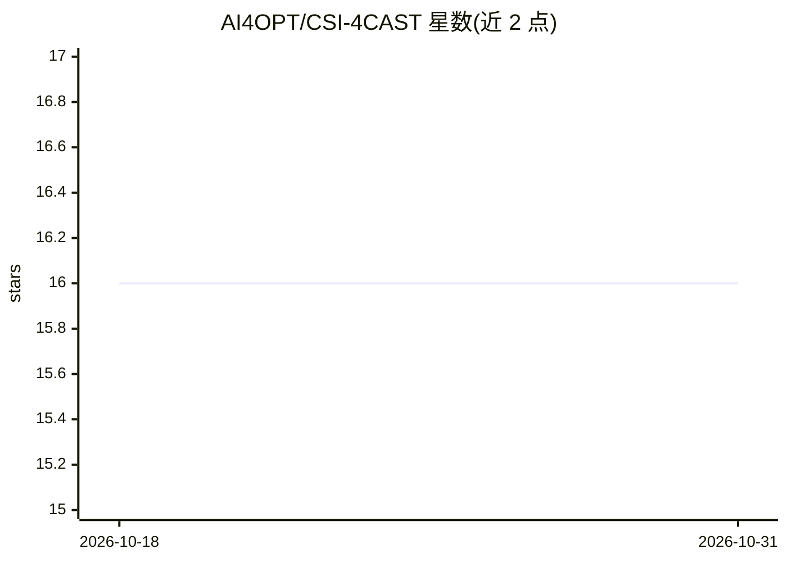

# AI4OPT/CSI-4CAST

⭐ 16 · Python · Apache-2.0 · 推送 2026-05-29 · [GitHub](https://github.com/AI4OPT/CSI-4CAST) · 组织维护

**面向科研的CSI预测深度学习框架：数据生成、训练与评测**

基于3GPP TR 38.901信道模型（Sionna实现）的信道状态信息预测全流程框架：提供大规模CSI数据集生成管线（含Hugging Face公开数据集下载）、基于PyTorch Lightning的模型训练（提出模型FDD/TDD、消融变体及统计/学习基线）、噪声建模与多场景评测（NMSE与SE排名、可视化套件），并附带可复用的Optuna超参数调优框架，支持SLURM集群与本地运行。面向无线通信与深度学习交叉方向的科研人员。

## 筛选速览

| 维度 | 判定 | 备注 |
|---|---|---|
| AI 角色 | `ai-native` | 本体是模型或模型工具 |
| 许可风险 | `permissive` | Apache-2.0 |
| 部署形态 | `None` |  |
| 模型依赖 | — | README 未给出锁定关系 |
| 硬件要求 | — | 无带数字的原话,不猜 |
| 安装摩擦 | `low` | 无编译、无系统依赖或容器化 |
| 成熟度 | — | 结构信号不足 |

## 能力要点

- 基于Sionna 3GPP TR 38.901的CSI数据集生成管线（含Hugging Face公开数据）
- PyTorch Lightning训练框架：提出模型、消融变体、统计与学习基线均包含
- 多维度评测：噪声/泛化/鲁棒性、计算开销 profiling、可视化套件
- 可复用的Optuna调参框架ahpt，支持SLURM编排与dashboard监控

## 适用场景

- 复现论文实验或使用公开权重与数据集做CSI预测研究
- 生成3GPP信道模型驱动的自定义CSI训练/测试数据
- 在SLURM集群上批量运行CSI预测模型训练与超参数调优
- 对比自研CSI预测模型与统计/学习基线的性能

## 场景标签

`模型评测` `科研工具` `模型训练` · 领域:评测与运维

## 证据(README 行号)

> L9: CSI-4CAST is a comprehensive framework for generating and evaluating Channel State Information (CSI) prediction mode
> L11: This framework is developed as part of our research paper **CSI-4CAST: A Hybrid Deep Learning Model for CSI Predict
> L80:  - **`baseline/`**: Baseline implementations including NP, AR, PAD, Wiener, CNN, RNN, STEMGNN, and LLM4CP

## 星数曲线

2026-10-18 16 → 2026-10-31 16（+0）

---
*卡片 v1 · prompt 1.4 · 生成 2026-10-30 · 置信度 high · 依据 README sha `d13effca6404` · [字段定义](../../DATASET.md)*
