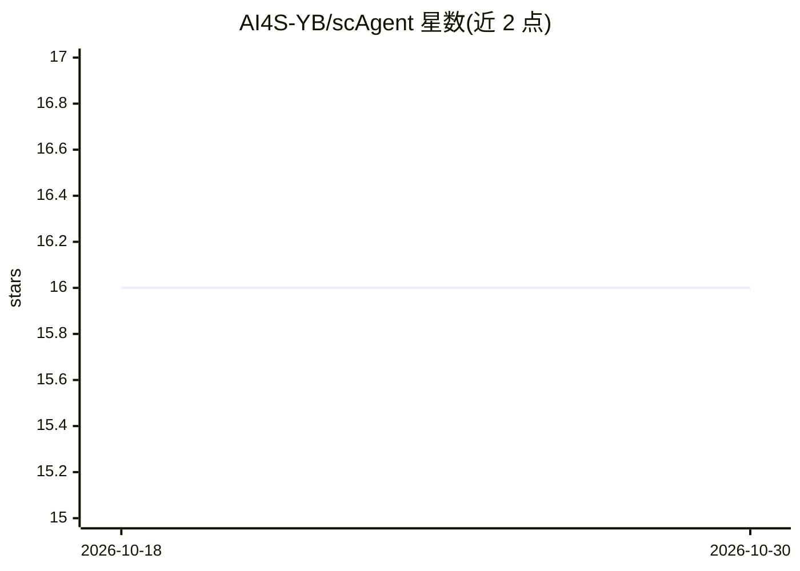

# AI4S-YB/scAgent

⭐ 16 · Go · 推送 2026-03-24 · [GitHub](https://github.com/AI4S-YB/scAgent) · 组织维护 · 中文 README

**面向生物学家的无代码单细胞分析 LLM Agent 平台**

由 Go 控制平面、Python 分析运行时与静态前端组成的单细胞分析系统：上传 .h5ad 文件后，通过三阶段 LLM 执行管线（decide→investigate→respond）自动生成分析计划并调度 32 个已接线的技能，覆盖质控、标准化、降维、聚类、差异表达与可视化全流程。支持多工作区共享、后台任务与 SSE 流式更新、Skill Hub 插件热加载及可选微信桥接。LLM 规划通过 OpenAI 兼容 API 配置。项目仍标注多项功能在开发中（大量 planned 技能、迁移加固不足）。

## 筛选速览

| 维度 | 判定 | 备注 |
|---|---|---|
| AI 角色 | `ai-native` | 本体是模型或模型工具 |
| 许可风险 | `none` | — |
| 部署形态 | `None` |  |
| 模型依赖 | — | README 未给出锁定关系 |
| 硬件要求 | — | 无带数字的原话,不猜 |
| 安装摩擦 | `low` | 无编译、无系统依赖或容器化 |
| 成熟度 | `idea` | |

## 能力要点

- 三阶段 LLM 执行管线：决定→调查→应答，支持中途回评与重规划
- 32 个已接线技能覆盖单细胞分析全流程（QC/降维/聚类/差异表达/导出）
- Skill Hub 插件包动态加载，无需重启服务器
- 可选微信桥接，支持语音与文本消息交互

## 适用场景

- 不写代码，通过对话完成单细胞 RNA-seq 分析流程
- 多对话共享同一工作区数据并隔离任务历史
- 通过微信对话触发和管理分析任务

## 场景标签

`数据分析` · 领域:效率与自动化

## 证据(README 行号)

> L5: `scAgent` supports workspace-based object sharing, conversation-scoped job/message history, a three-phase LLM execut
> L12: - Execute 32 `wired` skills covering the full single-cell analysis pipeline:
> L169: 1. **Decide** — determine whether the request can be answered directly (simple QA) or requires analysis execution.

## 星数曲线

2026-10-18 16 → 2026-10-30 16（+0）

---
*卡片 v1 · prompt 1.4 · 生成 2026-10-30 · 置信度 high · 依据 README sha `0ec65e87e0b2` · [字段定义](../../DATASET.md)*
