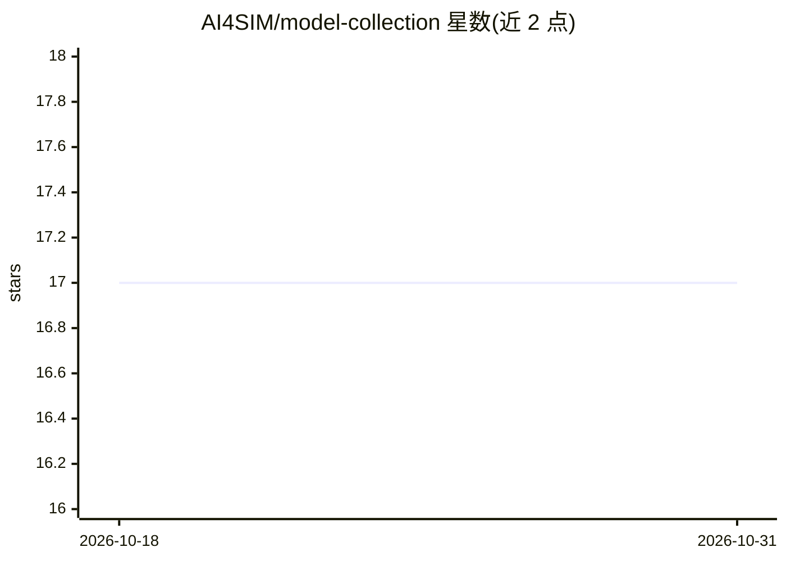

# AI4SIM/model-collection

⭐ 17 · Python · Apache-2.0 · 推送 2026-10-20 · [GitHub](https://github.com/AI4SIM/model-collection) · 组织维护

**物理过程代理模型的 PyTorch Lightning 训练管线集合**

Atos AI4SIM 团队与 CERFACS、ECMWF 等伙伴合作维护的深度学习模型合集，面向科研用途。按 <domain>/<use-case>/<NN architecture> 路径组织独立模型项目，覆盖 CFD 燃烧（UNet/GNN）、重力波拖曳（CNN）、3D 云辐射校正、NWP 模拟（PanguWeather）等用例。每个项目提供统一的 PyTorch Lightning DataModule/Module 双管线、YAML 配置训练、Docker 或 uv 虚拟环境运行；已集成模型项目视为冻结，仅处理重大缺陷。

## 筛选速览

| 维度 | 判定 | 备注 |
|---|---|---|
| AI 角色 | `ai-native` | 本体是模型或模型工具 |
| 许可风险 | `permissive` | Apache-2.0 |
| 部署形态 | `self-host` | docker 或自建部署 |
| 模型依赖 | — | README 未给出锁定关系 |
| 硬件要求 | — | 无带数字的原话,不猜 |
| 安装摩擦 | `low` | 无编译、无系统依赖或容器化 |
| 成熟度 | — | 结构信号不足 |

## 能力要点

- 按领域/用例/架构组织的独立模型项目集合
- 统一的 Lightning 数据与模型双管线及 CLI 训练
- 每个模型项目可构建基于 Ubuntu+CUDA 的 Docker 镜像
- 覆盖 CFD 燃烧与天气预报（含 PanguWeather 模拟）用例

## 适用场景

- 用代理模型替代 CFD 或数值天气预报仿真运行
- 复用规范化的 Lightning 管线训练物理过程神经网络
- 参考既有项目结构贡献新的物理 AI 模型

## 场景标签

`科研工具` · 领域:学习与行业

## 证据(README 行号)

> L7: This project contains a collection of models developed by the Atos AI4SIM R&D team and is intended for research purp
> L25:  - Numerical Weather Prediction (NWP) emulation (with PanguWeather)

## 星数曲线

2026-10-18 17 → 2026-10-31 17（+0）

---
*卡片 v1 · prompt 1.4 · 生成 2026-10-30 · 置信度 high · 依据 README sha `0ad95f7111d9` · [字段定义](../../DATASET.md)*
