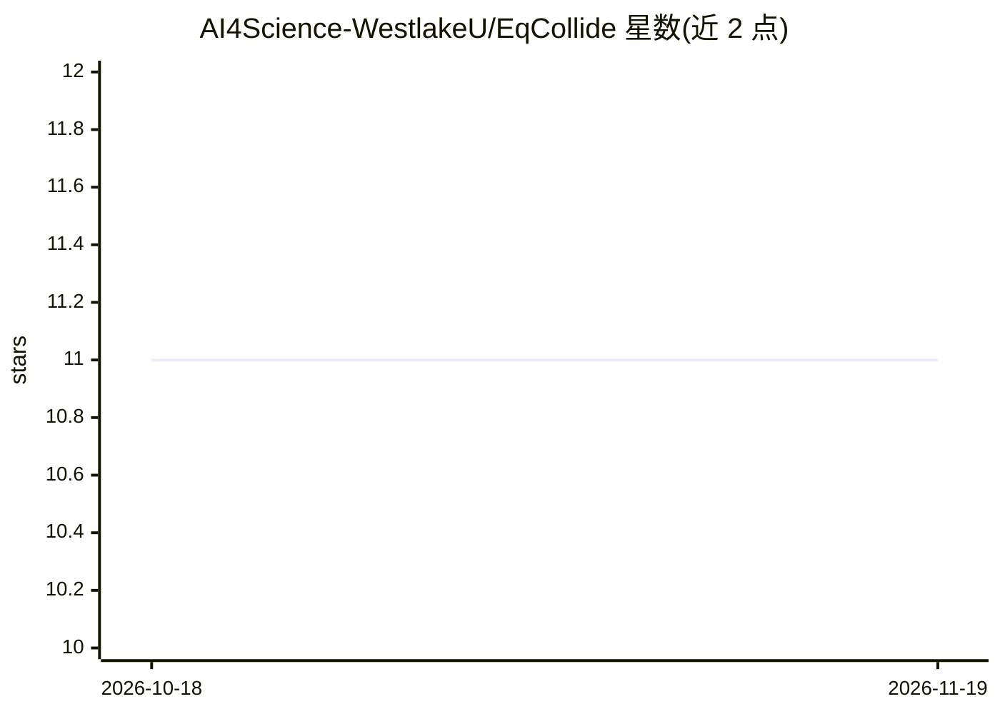

# AI4Science-WestlakeU/EqCollide

⭐ 11 · Python · NOASSERTION · 推送 2026-06-15 · [GitHub](https://github.com/AI4Science-WestlakeU/EqCollide) · 组织维护

**面向科研人员的可形变物体碰撞等变神经模拟器官方实现**

KDD 2026 AI4Science Track Oral 论文 EqCollide 的官方代码库。流程为：等变编码器将拉格朗日质量点（位置+速度）映射到少量潜控制点，碰撞感知的等变 GNN-NODE 演化潜状态，等变神经场解码连续、分辨率无关的速度场，全管线对输入刚体变换保持 SE(n) 等变。README 提供 conda 环境文件、Google Drive 托管的 2D/3D 轨迹数据与预训练 checkpoints、Hydra 配置的两阶段训练脚本与推理评估入口。要求 Linux、Python 3.11 与 CUDA 12 GPU；代码许可为 CC BY-NC 4.0。

## 筛选速览

| 维度 | 判定 | 备注 |
|---|---|---|
| AI 角色 | `ai-native` | 本体是模型或模型工具 |
| 许可风险 | `none` | NOASSERTION |
| 部署形态 | `None` |  |
| 模型依赖 | — | README 未给出锁定关系 |
| 硬件要求 | — | 无带数字的原话,不猜 |
| 安装摩擦 | `medium` | 含编译或系统依赖之一 |
| 成熟度 | — | 结构信号不足 |

## 能力要点

- 端到端等变神经场模拟器，碰撞感知 GNN-NODE 潜空间动力学
- 解码连续、分辨率无关的速度场，全管线 SE(n) 等变
- 提供 2D/3D 预训练 checkpoints 与 Google Drive 托管轨迹数据
- 2D 支持几何/组合/多物体三类泛化推理模式

## 适用场景

- 复现论文中可形变物体碰撞的神经模拟实验
- 在未见形状、未见组合与多物体场景上测试模拟器泛化
- 基于等变神经场开展物理仿真相关研究

## 场景标签

`科研工具` · 领域:学习与行业

## 证据(README 行号)

> L8: Official implementation of **EqCollide** (accepted at **KDD 2026**, AI4Science track, selected as **Oral**).
> L20: **EqCollide** is an end-to-end **equivariant neural-field simulator** for deformable-object collisions. An equivari

## 星数曲线

2026-10-18 11 → 2026-11-19 11（+0）

---
*卡片 v1 · prompt 1.4 · 生成 2026-11-19 · 置信度 high · 依据 README sha `3830b4909d51` · [字段定义](../../DATASET.md)*
