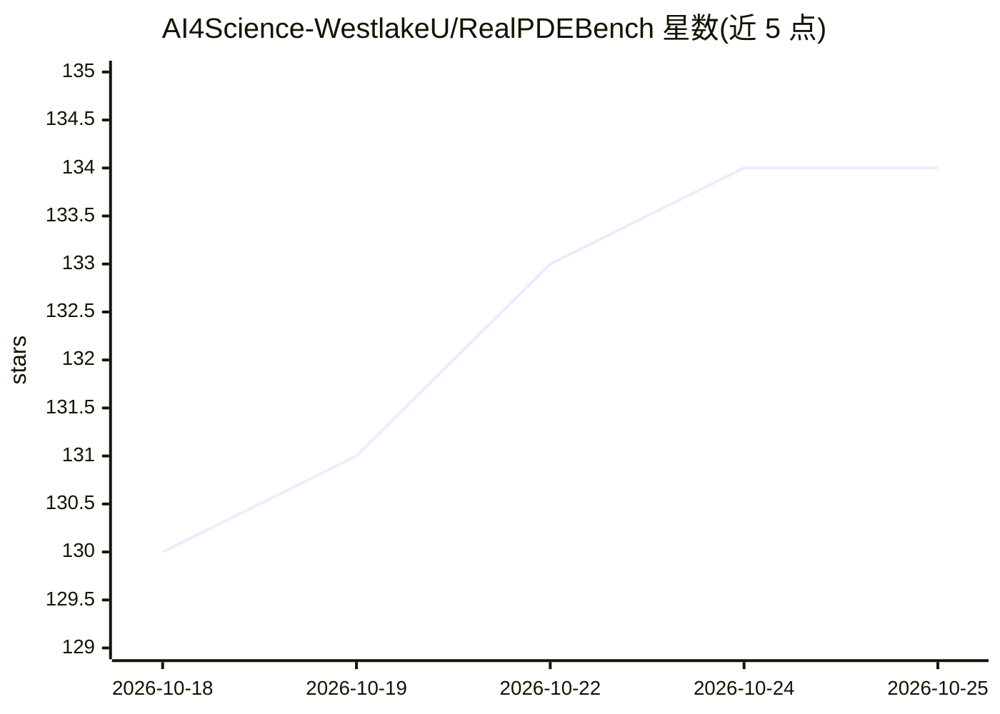

# AI4Science-WestlakeU/RealPDEBench

⭐ 134 · Python · NOASSERTION · 推送 2026-07-16 · [GitHub](https://github.com/AI4Science-WestlakeU/RealPDEBench) · [官网](https://realpdebench.github.io/) · 组织维护 · 中文 README

**配对真实/仿真数据的复杂物理系统科学 ML 基准（5 场景，700+ 轨迹）**

由西湖大学等机构维护的科学机器学习基准，提供 5 个物理场景（圆柱绕流、流固耦合、受控圆柱、翼型、燃烧）的配对真实测量与数值模拟数据，共 700+ 条轨迹，含 10 个基线模型（U-Net、FNO、DeepONet、DPOT 等）与 9 种评测指标，面向时空预测与 sim-to-real 迁移。通过 pip 安装，数据托管于 Hugging Face（支持 hf-mirror），另提供 HDF5 原始数据与全部训练好的 checkpoint。轨迹按参数分布划分为训练/分布内/分布外测试组。许可证为 CC BY-NC 4.0。

## 筛选速览

| 维度 | 判定 | 备注 |
|---|---|---|
| AI 角色 | `ai-knowledge` | 知识聚合/清单类 |
| 许可风险 | `none` | NOASSERTION |
| 部署形态 | `library` | 以包/库形式分发 |
| 模型依赖 | — | README 未给出锁定关系 |
| 硬件要求 | — | 无带数字的原话,不猜 |
| 安装摩擦 | `low` | 无编译、无系统依赖或容器化 |
| 成熟度 | — | 结构信号不足 |

## 能力要点

- 5 个物理场景、700+ 配对真实/仿真轨迹
- 10 个基线模型 × 5 场景 × 3 种训练范式的已训练 checkpoint
- realpdebench download 命令行下载器，支持 hf-mirror 镜像
- 按 in_dist/out_dist/remain 参数域划分测试集

## 适用场景

- 评测神经算子等模型在真实物理系统上的时空预测能力
- 研究仿真到真实（sim-to-real）的迁移效果
- 在分布外参数条件下测试模型泛化

## 场景标签

`模型评测` · 领域:评测与运维

## 证据(README 行号)

> L29: RealPDEBench is the first scientific ML benchmark with **paired real-world measurements and matched numerical simul
> L33: - **5 Datasets**: `cylinder`, `fsi`, `controlled_cylinder`, `foil`, `combustion`
> L35: - **10 Baseline models**: U-Net, FNO, CNO, WDNO, DeepONet, MWT, GK-Transformer, Transolver, DPOT, DMD

## 星数曲线

2026-10-18 130 → 2026-10-25 134（+4）

---
*卡片 v1 · prompt 1.4 · 生成 2026-10-22 · 置信度 high · 依据 README sha `2e44706265e6` · [字段定义](../../DATASET.md)*
