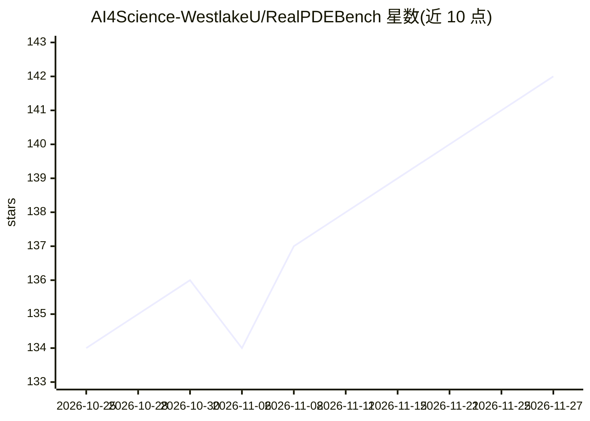

# AI4Science-WestlakeU/RealPDEBench

⭐ 142 · Python · NOASSERTION · 推送 2026-11-15 · [GitHub](https://github.com/AI4Science-WestlakeU/RealPDEBench) · [官网](https://realpdebench.github.io/) · 组织维护 · 中文 README

**科学 ML 基准：配对真实测量与仿真的物理系统预测评测**

面向复杂物理系统的科学机器学习基准，提供配对的真实世界测量与匹配数值仿真数据，用于时空预测与 sim-to-real 迁移评测。包含 5 个数据集（cylinder、fsi、controlled_cylinder、foil、combustion）、700+ 轨迹、10 个基线模型与 9 项评估指标。以 Python 包形式提供训练与评估命令行入口，数据与 10×5×3 训练范式的模型检查点托管在 Hugging Face，另有 Westlake 服务器上的 HDF5 原始数据分发。数据版本 v2.0.0 用于复现论文 Table 1，v2.0.1 用于新实验。许可证为 CC BY-NC 4.0。

## 筛选速览

| 维度 | 判定 | 备注 |
|---|---|---|
| AI 角色 | `ai-knowledge` | 知识聚合/清单类 |
| 许可风险 | `none` | NOASSERTION |
| 部署形态 | `library` | 以包/库形式分发 |
| 模型依赖 | — | README 未给出锁定关系 |
| 硬件要求 | — | 无带数字的原话,不猜 |
| 安装摩擦 | `low` | 无编译、无系统依赖或容器化 |
| 成熟度 | — | 结构信号不足 |

## 能力要点

- 5 个数据集、700+ 轨迹，真实测量与数值仿真配对
- 10 个基线模型与 9 项评估指标（RMSE、Rel L₂、MVPE 等）
- 10×5×3 训练范式的检查点托管于 Hugging Face
- HF Arrow 数据集支持惰性切片与自动下载

## 适用场景

- 为物理系统的时空预测模型寻找真实数据基准
- 研究 sim-to-real 迁移的训练与微调策略
- 复现论文 Table 1 或参与 RealPDE 竞赛

## 场景标签

`模型评测` · 领域:评测与运维

## 证据(README 行号)

> L35: RealPDEBench is the first scientific ML benchmark with **paired real-world measurements and matched numerical simul
> L41: - **10 Baseline models**: U-Net, FNO, CNO, WDNO, DeepONet, MWT, GK-Transformer, Transolver, DPOT, DMD

## 星数曲线

2026-10-25 134 → 2026-11-27 142（+8）

---
*卡片 v1 · prompt 1.4 · 生成 2026-11-27 · 置信度 high · 依据 README sha `03eaac023467` · [字段定义](../../DATASET.md)*
