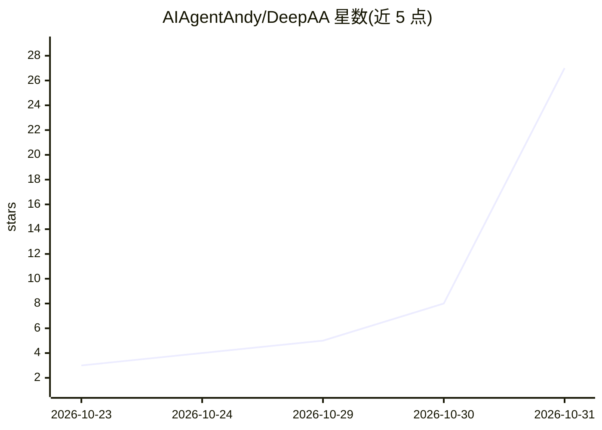

# AIAgentAndy/DeepAA

⭐ 27 · TypeScript · MIT · 推送 2026-10-23 · [GitHub](https://github.com/AIAgentAndy/DeepAA) · [官网](https://deepaa.dev) · 个人维护 · 中文 README

**本地运行的 AI Agent 网关，统一接入供应商并追踪调用与成本**

DeepAA（Deep Agent Analytics）是开源免费、本地运行的 AI Agent 网关与可观测分析工具，面向使用多家模型与 Agent 的开发者。它集中管理模型供应商、密钥与 Agent 配置，追踪 Agent 与模型间按任务/线程/轮次/步骤的调用链路，输出逐请求的 Token 费用拆解与计算依据，并支持模型级故障转移。已集成 Codex、Claude Code、OpenCode、DeepSeek Harness、ZCode 五种编码 Agent；观测数据仅保存在本机。支持 macOS 与 Windows，提供一键脚本、npm 与源码三种安装方式，需 Node.js 22.13+。

## 筛选速览

| 维度 | 判定 | 备注 |
|---|---|---|
| AI 角色 | `ai-ecosystem` | LLM/agent 周边工具 |
| 许可风险 | `permissive` | MIT |
| 部署形态 | `library` | 以包/库形式分发 |
| 模型依赖 | locked-api |  |
| 硬件要求 | — | 无带数字的原话,不猜 |
| 安装摩擦 | `low` | 无编译、无系统依赖或容器化 |
| 成熟度 | — | 结构信号不足 |

## 能力要点

- 统一管理官方/中转站供应商、模型、密钥与 Agent 配置
- Session→Thread→Turn→Step 调用链追踪与上下文构成证据
- 逐请求 Token 费用拆解（输入/缓存/输出）与套餐积分折算估算
- 模型级有序备份链故障转移，数据本地保存不上传

## 适用场景

- 我同时用多个编码 Agent 和供应商，想统一接入和管密钥
- 我想看清一次任务到底调了哪些模型、花了多少钱
- 模型通道异常时自动切换备份模型，减少工作中断

## 场景标签

`模型网关` `LLM 可观测性` · 领域:Agent 开发

## 证据(README 行号)

> L5: DeepAA（Deep Agent Analytics）是开源免费、本地运行的 **AI Agent 网关与可观测分析工具**。它统一管理模型供应商、模型、密钥与 Agent 配置，追踪 Agent 与模型之间的调用链路，把用量、费
> L28: 当前已集成 **Codex、Claude Code、OpenCode、DeepSeek Harness、ZCode** 五种编码 Agent。可接入官方模型服务、套餐与订阅，以及聚合服务和自定义中转站；可用组合取决于协议、模型能力

## 星数曲线

2026-10-23 3 → 2026-10-31 27（+24）

---
*卡片 v1 · prompt 1.4 · 生成 2026-10-30 · 置信度 high · 依据 README sha `67dcdfbe2857` · [字段定义](../../DATASET.md)*
