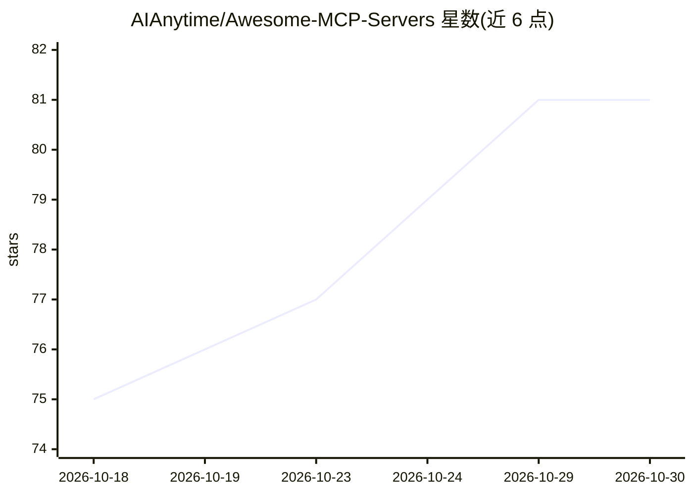

# AIAnytime/Awesome-MCP-Servers

⭐ 81 · Python · MIT · 推送 2026-10-28 · [GitHub](https://github.com/AIAnytime/Awesome-MCP-Servers) · [官网](https://mcp.aianytime.net) · 组织维护

**MCP 服务器策展目录＋Python 参考实现教学仓库**

由 AI Anytime 维护的双功能仓库：一是社区 MCP 服务器分类目录，每晚对每个托管服务器发起真实 MCP 握手，在站点展示在线状态、鉴权要求、工具数量与上下文开销；二是教学部分，提供 weather、PubMed、Wikipedia 等 7 个可本地运行的 Python 参考服务器实现，以及 SSE 远程服务模板与 Streamlit MCP host 示例。面向想学习 MCP 协议或为 AI 助手挑选工具服务器的开发者，README 提醒收录不等于安全审查。

## 筛选速览

| 维度 | 判定 | 备注 |
|---|---|---|
| AI 角色 | `ai-knowledge` | 知识聚合/清单类 |
| 许可风险 | `permissive` | MIT |
| 部署形态 | `self-host` | docker 或自建部署 |
| 模型依赖 | — | README 未给出锁定关系 |
| 硬件要求 | — | 无带数字的原话,不猜 |
| 安装摩擦 | `low` | 无编译、无系统依赖或容器化 |
| 成熟度 | — | 结构信号不足 |

## 能力要点

- 每晚对托管服务器做真实 MCP 握手并展示在线状态与工具数
- 7 个自包含的 Python 参考服务器实现（stdio/SSE/HTTP）
- directory-mcp 可在 MCP 客户端内按关键词/类别/在线状态检索本目录
- 社区目录按类别组织，标注 stdio/http/sse 运行形态

## 适用场景

- 为 Claude 等 MCP 客户端查找可用的社区服务器
- 克隆参考实现学习如何编写 MCP 服务器
- 通过在线状态与工具数筛选可靠的 MCP 服务器

## 场景标签

`精选清单` `教程课程` · 领域:学习与行业

## 证据(README 行号)

> L19: 1. **A directory** — a categorized list of MCP servers the community has built and shipped. Every hosted server is 
> L20: 2. **A teaching repo** — small, readable server implementations in Python you can clone, run, and copy from.
> L22: Built and maintained by AI Anytime. Additions come from the community — see Contributing.

## 星数曲线

2026-10-18 75 → 2026-10-30 81（+6）

---
*卡片 v1 · prompt 1.4 · 生成 2026-10-24 · 置信度 mid · 依据 README sha `69ab82b9629b` · [字段定义](../../DATASET.md)*
