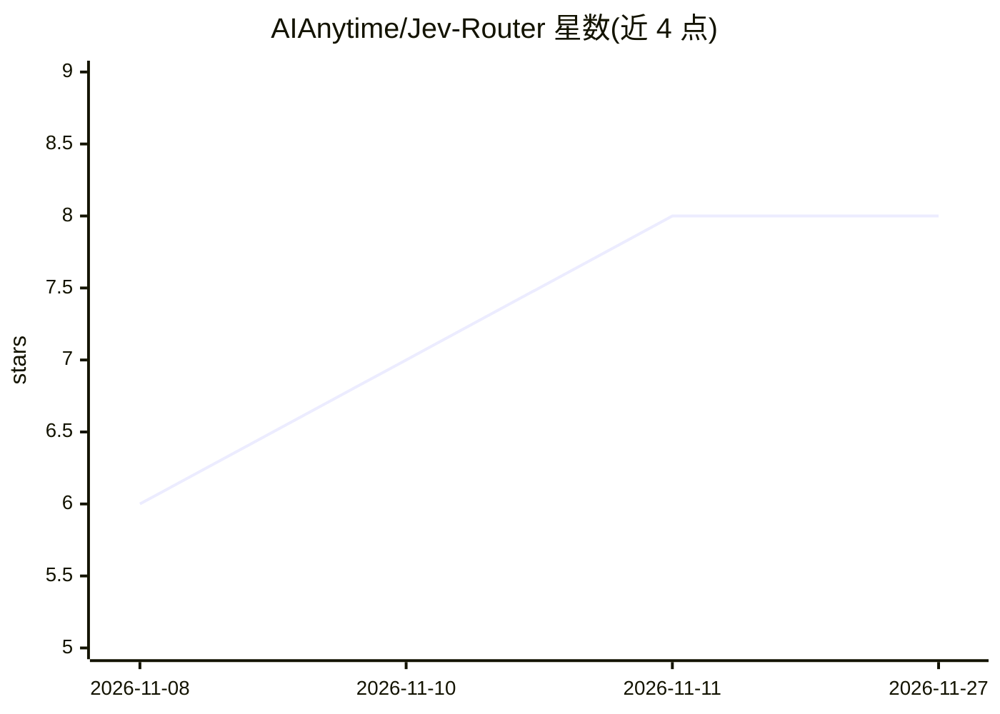

# AIAnytime/Jev-Router

⭐ 8 · Python · MIT · 推送 2026-11-04 · [GitHub](https://github.com/AIAnytime/Jev-Router) · [官网](https://jevrouter.aianytime.net/) · 个人维护

**OpenAI 兼容的 LLM 路由网关：按请求分派模型/agent/工具**

基于 FastAPI 的决策优先 AI 路由器，提供单一 OpenAI 兼容端点，将每个请求路由到合适的模型、agent 或工具。通过 Jev 类型化决策（choice/score/noul 概率化答案）驱动透明策略引擎，先按上下文窗口、模态、预算、允许列表等硬约束过滤候选，再排名执行，失败时自动降级；每次请求留存可审计的决策 trace。内置仪表盘展示花费、延迟、模型分布与 trace 浏览器，提供 30 条 prompt 的路由评测脚本可自行复现。

## 筛选速览

| 维度 | 判定 | 备注 |
|---|---|---|
| AI 角色 | `ai-ecosystem` | LLM/agent 周边工具 |
| 许可风险 | `permissive` | MIT |
| 部署形态 | `self-host` | docker 或自建部署 |
| 模型依赖 | local-ok | 支持本地模型 |
| 硬件要求 | — | 无带数字的原话,不猜 |
| 安装摩擦 | `low` | 无编译、无系统依赖或容器化 |
| 成熟度 | — | 结构信号不足 |

## 能力要点

- OpenAI 兼容端点 /v1/chat/completions（含流式）与 /v1/models
- 模型、agent、工具、守护栏四种路由，五种可选策略（balanced/quality/cheapest/fastest/privacy）
- 自动降级：Jev 不可用时本地启发式路由器接管，trace 记录每次尝试
- 内置仪表盘：花费、延迟、trace 浏览器与 playground

## 适用场景

- 生产流量中按任务难度自动分配模型以控制成本
- 敏感数据场景优先路由到本地模型
- 为任务自动选择 agent 并标记需要人工审批的请求
- 在请求到达模型前拦截注入/有害内容并给出 allow/review/deny 判定

## 场景标签

`模型网关` `模型评测` · 领域:Agent 开发

## 证据(README 行号)

> L3: **The decision-first AI router.** One OpenAI-compatible endpoint that sends every request to the right model, agent 
> L39: - **Drop-in OpenAI API.** `/v1/chat/completions` (streaming included) and `/v1/models`. Works with the OpenAI SDKs,
> L42: - **Four routers in one.** Model routing, agent routing, tool routing and policy (guardrail) routing.

## 星数曲线

2026-11-08 6 → 2026-11-27 8（+2）

---
*卡片 v1 · prompt 1.4 · 生成 2026-11-20 · 置信度 high · 依据 README sha `668746338ee8` · [字段定义](../../DATASET.md)*
