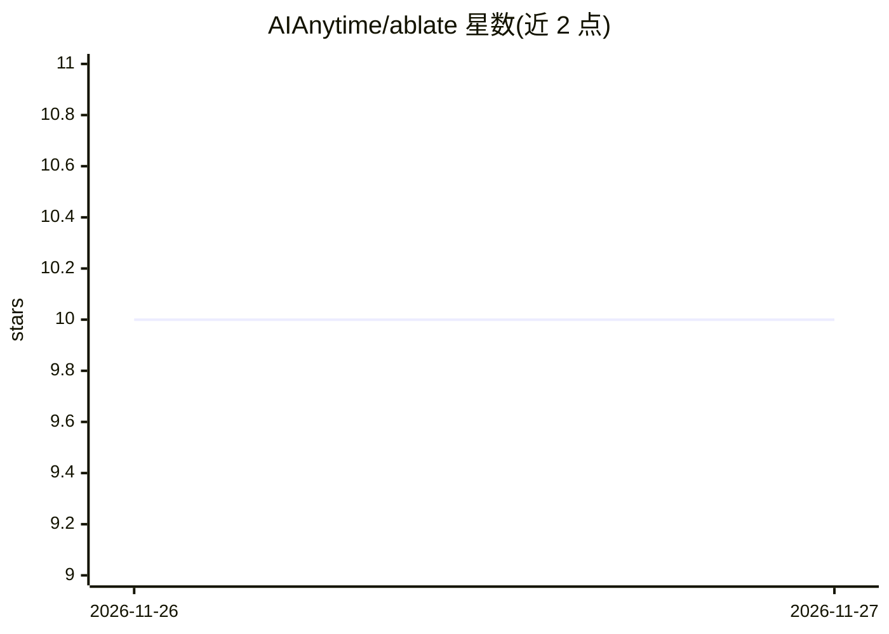

# AIAnytime/ablate

⭐ 10 · HTML · Apache-2.0 · 推送 2026-11-07 · [GitHub](https://github.com/AIAnytime/ablate) · [官网](https://aianytime.github.io/ablate/) · 组织维护

**本地聊天的开源 SLM 及其 abliteration 去审查工具包**

Python 工具包与应用的组合：通过在残差流中定位拒绝方向并投影消融（运行时 hook 或权重正交化）去除模型拒绝行为，配有 KL 散度引导的 Optuna 搜索、可插拔评测裁判（关键词/LLM/分类器）与一键推送 Hub 的模型卡生成。附带本地聊天应用（SQLite 存储、OpenAI 兼容 API、自托管 vLLM/Ollama 等后端连接）与实验性终端编码 agent。面向机械可解释性与安全研究者，定位为 Venice AI 与 abliteration.ai 的开源替代，Apache-2.0 许可。README 明示 1-3B 模型在 agent 模式下无法完成简单 bug 修复。

## 筛选速览

| 维度 | 判定 | 备注 |
|---|---|---|
| AI 角色 | `ai-ecosystem` | LLM/agent 周边工具 |
| 许可风险 | `permissive` | Apache-2.0 |
| 部署形态 | `library` | 以包/库形式分发 |
| 模型依赖 | locked-api |  |
| 硬件要求 | — | 无带数字的原话,不猜 |
| 安装摩擦 | `medium` | 含编译或系统依赖之一 |
| 成熟度 | — | 结构信号不足 |

## 能力要点

- 残差流方向消融：运行时 hook 或权重正交化两种方式
- Optuna 搜索最小化 refusal_rate + λ·KL，带连贯性下限
- 可插拔评测：KeywordJudge/LLMJudge/HFClassifierJudge，报告 ASR
- 本地聊天应用支持 OpenAI 兼容 API 与自托管后端

## 适用场景

- 研究安全行为在模型中的表征方式
- 生成去审查版本的本地小模型并推送 Hub
- 在自己的电脑上离线运行无限制小模型聊天
- 用 HarmBench 与 LLM 裁判做基线对比评测

## 场景标签

`模型评测` `聊天机器人` · 领域:对话与助手

## 证据(README 行号)

> L131: Three ways in (browser UI, CLI, Python API), one `Ablator` pipeline, no training.
> L187: pip install ablate-llm          # the import name is still `ablate`

## 星数曲线

2026-11-26 10 → 2026-11-27 10（+0）

---
*卡片 v1 · prompt 1.4 · 生成 2026-11-26 · 置信度 high · 依据 README sha `6079c799cd30` · [字段定义](../../DATASET.md)*
