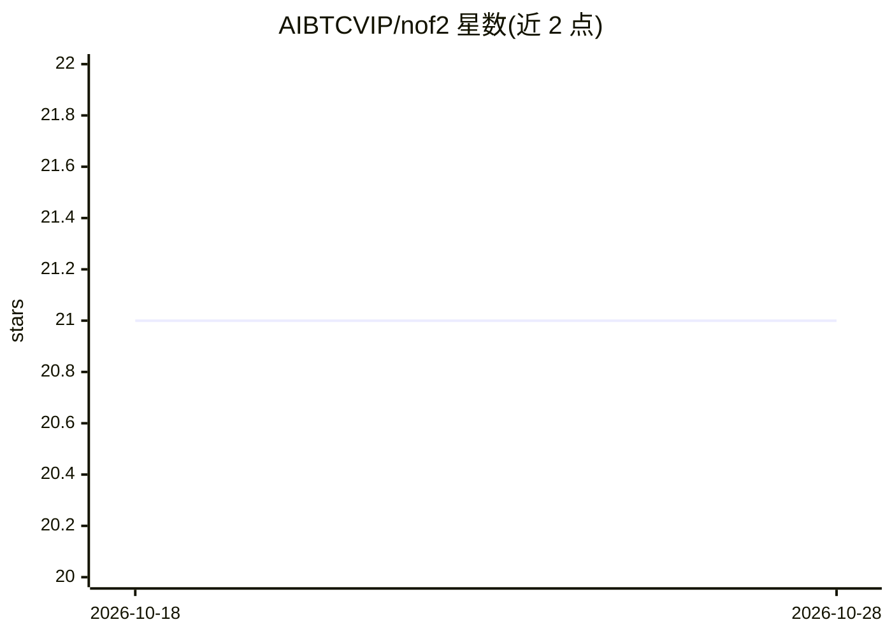

# AIBTCVIP/nof2

⭐ 21 · Python · 推送 2025-12-29 · [GitHub](https://github.com/AIBTCVIP/nof2) · [官网](https://t.me/aibtcchina) · 个人维护 · 中文 README

**币安加密货币交易机器人，AI 可插拔推理决策**

面向加密货币交易者的自托管交易系统：读取市场数据，经 AI 推理生成决策，通过币安 API 执行交易，提供本地 Web 前端（端口 8600）访问。安装方式为在 config.py 填入币安 API 密钥后 pip 安装依赖并运行 main.py。README 未说明所接入的具体 AI 模型或推理机制细节，内容以社区链接与作者自营 API 中转服务广告为主。

## 筛选速览

| 维度 | 判定 | 备注 |
|---|---|---|
| AI 角色 | `ai-native` | 本体是模型或模型工具 |
| 许可风险 | `none` | — |
| 部署形态 | `library` | 以包/库形式分发 |
| 模型依赖 | — | README 未给出锁定关系 |
| 硬件要求 | — | 无带数字的原话,不猜 |
| 安装摩擦 | `low` | 无编译、无系统依赖或容器化 |
| 成熟度 | — | 结构信号不足 |

## 能力要点

- 市场数据→AI 推理→交易执行的流程结构
- 自托管运行，本地 Web 前端（127.0.0.1:8600）
- 通过 config.py 配置币安 API 密钥接入

## 适用场景

- 想自托管运行币安交易机器人的加密货币交易者
- 通过 Web 前端查看与操作交易系统

## 场景标签

`金融量化` · 领域:学习与行业

## 证据(README 行号)

> L13: 配置文件config.py填入您的币安API就可以了
> L17: 启动:python3 main.py

## 星数曲线

2026-10-18 21 → 2026-10-28 21（+0）

---
*卡片 v1 · prompt 1.4 · 生成 2026-10-28 · 置信度 low · 依据 README sha `63683ea69a75` · [字段定义](../../DATASET.md)*
