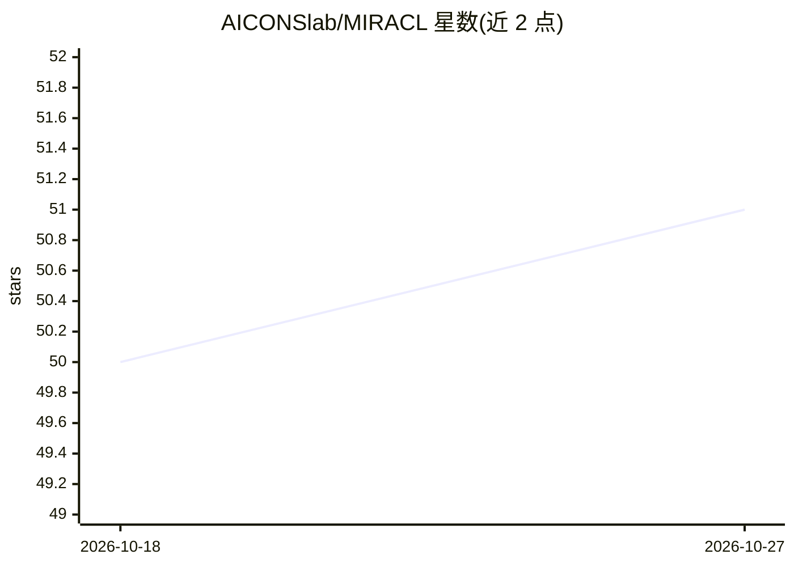

# AICONSlab/MIRACL

⭐ 51 · Python · NOASSERTION · 推送 2026-10-21 · [GitHub](https://github.com/AICONSlab/MIRACL) · [官网](https://miracl.readthedocs.io) · 组织维护

**神经影像多模态配准与连接分析开源流水线**

面向 cleared 与影像数据（如 LSFM、MRI）的开源自动化分析流水线：到参考图谱（如 Allen Reference Atlas）的配准、cleared 数据的 3D 分割与特征提取、连接分析、统计比较、图谱生成与标签操作。包含深度学习工作流：MAPL3（光片显微镜单轴突水平的脑连接映射）与 ACE（脑区活动/形态/连接变化映射）。推荐以 Docker/Apptainer 容器安装，2.4.2 版起预训练模型安装时自动下载；2.5.0 版起许可由 GPL-3.0 改为 CC BY-NC-ND 4.0（禁止商用与演绎）。

## 筛选速览

| 维度 | 判定 | 备注 |
|---|---|---|
| AI 角色 | `ai-native` | 本体是模型或模型工具 |
| 许可风险 | `none` | NOASSERTION |
| 部署形态 | `self-host` | docker 或自建部署 |
| 模型依赖 | — | README 未给出锁定关系 |
| 硬件要求 | — | 无带数字的原话,不猜 |
| 安装摩擦 | `low` | 无编译、无系统依赖或容器化 |
| 成熟度 | — | 结构信号不足 |

## 能力要点

- LSFM/MRI 数据到 Allen Reference Atlas 的自动配准
- MAPL3：光片显微镜数据单轴突水平脑连接映射深度学习流水线
- ACE：脑区/皮层分层水平的活动与形态变化自动映射
- 提供 Docker/Apptainer 容器，预训练模型自动下载

## 适用场景

- 显微清除脑样本到参考图谱的自动配准与分割
- 光片显微镜数据的轴突连接定量制图
- 脑连接组成像数据的统计分析与图谱比较

## 场景标签

 · 领域:神经影像/神经科学

## 证据(README 行号)

> L5: **MIRACL** (**M**ulti-modal **I**mage **R**egistration **A**nd **C**onnectivity ana**L**ysis) is a general-purpose, 
> L16: We will soon release our **M**apping **A**xonal **P**rojections in **L**ight-sheet Fluorescence Microscopy in **3**
> L25: We have released our AI-based Cartography of Ensembles (ACE) workflow, an end-to-end, automated pipeline that integ

## 星数曲线

2026-10-18 50 → 2026-10-27 51（+1）

---
*卡片 v1 · prompt 1.4 · 生成 2026-10-24 · 置信度 high · 依据 README sha `9a10724c50a8` · [字段定义](../../DATASET.md)*
