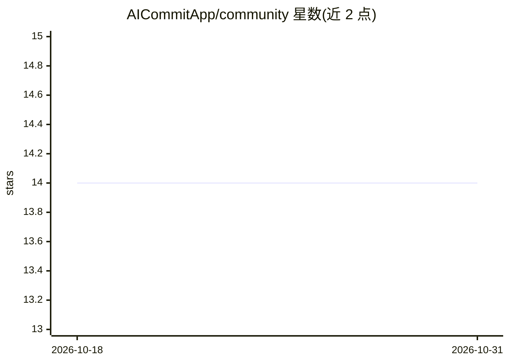

# AICommitApp/community

⭐ 14 · MIT · 推送 2026-02-27 · [GitHub](https://github.com/AICommitApp/community) · [官网](https://aicommit.app) · 组织维护 · 中文 README

**JetBrains IDE 插件：一键生成 git 提交信息**

面向 JetBrains IDE 用户的提交信息生成插件：在 VCS 提交面板一键生成上下文感知的 commit message，支持 OpenAI、Azure OpenAI、Google Gemini、Anthropic Claude 及 Ollama（本地模型）多种提供方。提供 Prompt Lab 进行提供方/模型切换与提示模板管理，支持自定义 Conventional Commits、release notes 等模板，可保留生成历史与最近提交上下文。通过 IDE 内置插件市场安装，配置提供方 API key 或端点并验证后使用。

## 筛选速览

| 维度 | 判定 | 备注 |
|---|---|---|
| AI 角色 | `ai-native` | 本体是模型或模型工具 |
| 许可风险 | `permissive` | MIT |
| 部署形态 | `None` |  |
| 模型依赖 | local-ok | 支持本地模型 |
| 硬件要求 | — | 无带数字的原话,不猜 |
| 安装摩擦 | `low` | 无编译、无系统依赖或容器化 |
| 成熟度 | — | 结构信号不足 |

## 能力要点

- JetBrains VCS 提交面板一键生成提交信息
- 多提供方支持：OpenAI / Azure OpenAI / Gemini / Claude / Ollama（本地）
- Prompt Lab：提供方切换、提示模板与生成历史
- 自定义 Conventional Commits、release notes 等模板

## 适用场景

- 在 JetBrains IDE 里一键生成规范的提交信息
- 通过本地 Ollama 模型在隐私优先模式下生成提交信息
- 按团队规范定制提交信息模板

## 场景标签

`代码生成` · 领域:编码与开发

## 证据(README 行号)

> L22: - **One-Click Generation**: Generate commit messages instantly from the JetBrains VCS commit panel.
> L25: - **Multi-Provider AI**: OpenAI, Azure OpenAI, Google Gemini, Anthropic Claude, and Ollama (local models).

## 星数曲线

2026-10-18 14 → 2026-10-31 14（+0）

---
*卡片 v1 · prompt 1.4 · 生成 2026-10-31 · 置信度 high · 依据 README sha `b522cebee969` · [字段定义](../../DATASET.md)*
