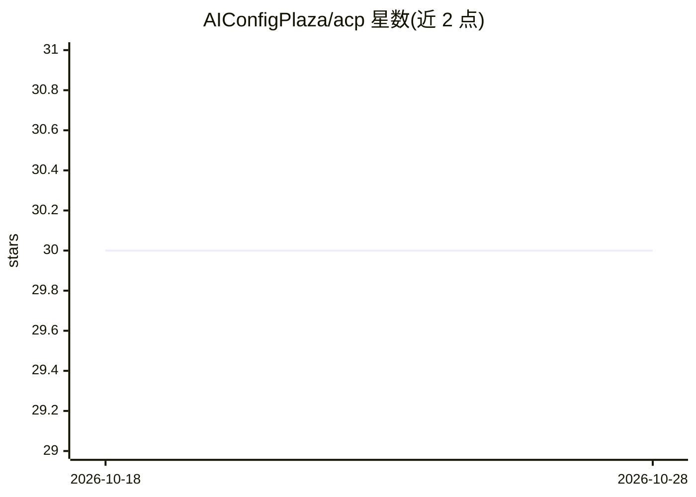

# AIConfigPlaza/acp

⭐ 30 · TypeScript · Apache-2.0 · 推送 2026-03-12 · [GitHub](https://github.com/AIConfigPlaza/acp) · [官网](https://ai-config-plaza.com) · 组织维护 · 中文 README

**AI 编程工具配置的共享市场与一键应用 CLI**

面向使用 AI 编程工具的开发者，解决 MCP、Agent 配置、自定义指令、Agent skills 等配置的碎片化与重复配置问题。平台支持将多种配置组合为 Solution 方案，并与 Claude Code、Copilot、Codex、Cursor 等主流工具绑定；提供 CLI（acp login/apply）登录后搜索、分页浏览并一键拉取配置到本地项目，支持中英文界面与配置覆盖确认。社区机制含公开分享、点赞、下载统计与个人中心。

## 筛选速览

| 维度 | 判定 | 备注 |
|---|---|---|
| AI 角色 | `ai-ecosystem` | LLM/agent 周边工具 |
| 许可风险 | `permissive` | Apache-2.0 |
| 部署形态 | `None` |  |
| 模型依赖 | — | README 未给出锁定关系 |
| 硬件要求 | — | 无带数字的原话,不猜 |
| 安装摩擦 | `low` | 无编译、无系统依赖或容器化 |
| 成熟度 | — | 结构信号不足 |

## 能力要点

- 统一管理 MCP 配置、Agent.md、自定义指令、Agent skills 多种格式
- 多配置打包为 Solution 方案并与主流 AI 编程工具绑定
- CLI 交互式搜索、分页浏览并一键应用配置到本地项目
- CLI 支持中英文界面（zh-CN 默认 / en-US）

## 适用场景

- 在多个 AI 编程工具间复用和迁移 MCP 与 Agent 配置
- 从社区查找经点赞筛选的现成配置方案，避免从零配置
- 统一管理个人配置的公开/私有权限并跟踪下载统计

## 场景标签

`提示工程` · 领域:Agent 开发

## 证据(README 行号)

> L5: **ACP (AI-Config-Plaza)** 是一个专注于简化AI编程工具配置的平台，旨在解决开发者在使用各类AI编程工具时面临的配置碎片化、重复劳动多、跨工具切换成本高的问题。通过统一的配置管理和社区共享机制，让AI工具配置
> L10: - **支持多种配置格式**：涵盖MCP配置、Agent.md配置、自定义指令（Prompt）、Agent skills等
> L78: - 无缝支持Claude Code、GitHub Copilot、OpenAI Codex、Cursor等主流AI编程工具

## 星数曲线

2026-10-18 30 → 2026-10-28 30（+0）

---
*卡片 v1 · prompt 1.4 · 生成 2026-10-26 · 置信度 high · 依据 README sha `b818aba2b8d1` · [字段定义](../../DATASET.md)*
