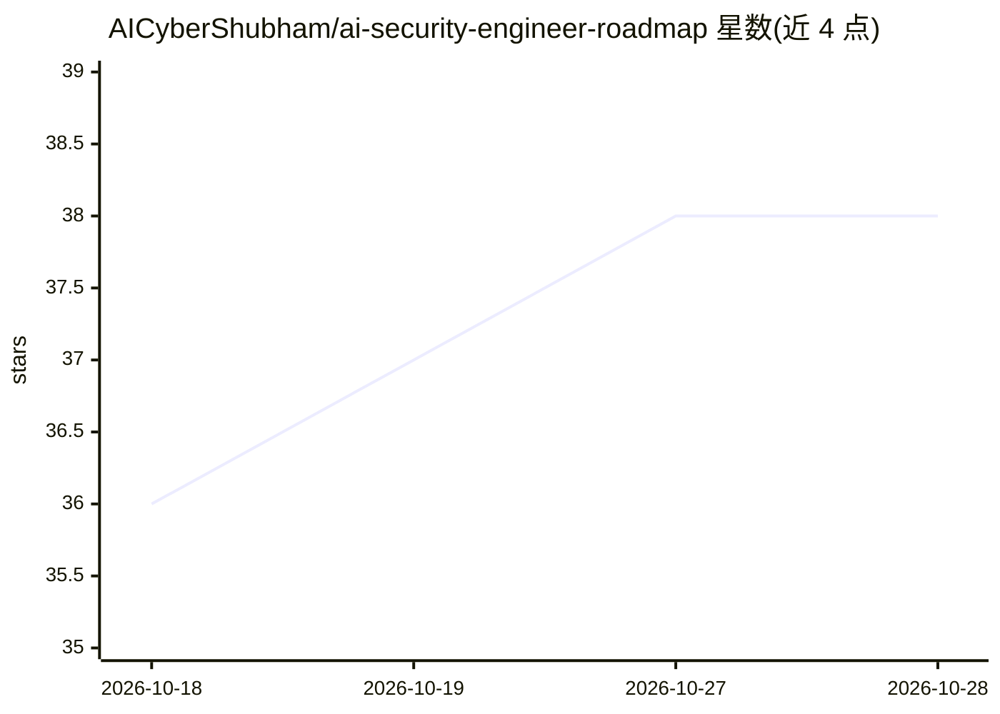

# AICyberShubham/ai-security-engineer-roadmap

⭐ 38 · NOASSERTION · 推送 2025-11-25 · [GitHub](https://github.com/AICyberShubham/ai-security-engineer-roadmap) · [官网](https://www.linkedin.com/in/shubham-kumar-pandey-iitp/) · 个人维护

**AI 安全工程师从零到进阶的 12 个月学习路线图**

由个人维护的结构化学习路线仓库，目标是从零基础培养 AI Security Engineer。内容分 6 个阶段（基础、ML/DL、LLM 工程、AI 用于网络安全、LLM 安全、毕业大项目），按 12 个月排期，列出 Python/Linux/网络、Scikit-learn/TensorFlow/PyTorch、LLM API 与 RAG、Guardrails 等技术栈、各阶段目标、日/周/月计划、安全数据集（CICIDS、NSL-KDD）及配套项目（IDS、钓鱼 URL 检测、LLM 防火墙等），最终项目为 AI-Powered Security Analyst 全栈系统。仓库本身为知识文档，不含可安装运行的软件。

## 筛选速览

| 维度 | 判定 | 备注 |
|---|---|---|
| AI 角色 | `ai-knowledge` | 知识聚合/清单类 |
| 许可风险 | `none` | NOASSERTION |
| 部署形态 | `None` |  |
| 模型依赖 | — | README 未给出锁定关系 |
| 硬件要求 | — | 无带数字的原话,不猜 |
| 安装摩擦 | `low` | 无编译、无系统依赖或容器化 |
| 成熟度 | — | 结构信号不足 |

## 能力要点

- 6 阶段、12 个月排期的学习路径与日/周/月目标
- 覆盖 ML/DL、LLM 工程、RAG 安全、入侵/异常检测等主题
- 列出 CICIDS 2017、NSL-KDD 等安全数据集与 5+ 实战项目
- 以 AI-Powered Security Analyst（AISA）作为毕业全栈项目

## 适用场景

- 按阶段自学成为 AI 安全工程师
- 查找 AI 安全方向的实战项目与数据集
- 规划日/周/月学习进度并建立作品集

## 场景标签

`教程课程` · 领域:学习与行业

## 证据(README 行号)

> L21: This repository contains a **complete, structured roadmap** to become an
> L34: Everything is broken into **6 Phases** with clear goals, examples, and deliverables.

## 星数曲线

2026-10-18 36 → 2026-10-28 38（+2）

---
*卡片 v1 · prompt 1.4 · 生成 2026-10-25 · 置信度 high · 依据 README sha `48057e9866b5` · [字段定义](../../DATASET.md)*
