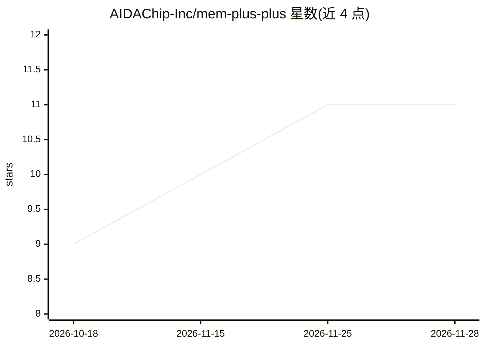

# AIDAChip-Inc/mem-plus-plus

⭐ 11 · Python · Apache-2.0 · 推送 2026-10-26 · [GitHub](https://github.com/AIDAChip-Inc/mem-plus-plus) · 组织维护

**为 LLM agent 提供非破坏性长期组织记忆的存储与检索引擎**

Mem++ 是面向处理组织记录（Slack、邮件、会议纪要、工单、文档）的 LLM agent 的记忆系统：写入路径原样保存每条带日期与贡献者的记录，不调用 LLM；读取时通过日期过滤（as-of 查询）、词法全文检索/pgvector 向量/实体标签三路索引加权 RRF 融合、保留最新记录槽位，输出带日期与署名的证据块交给回答模型。存储为 append-only，被取代记录只标记不删除。可选整合功能用 LLM 对近重复记录分组标注。默认本地 CPU ONNX MiniLM-384 嵌入，依赖 Python 3.13+ 与 PostgreSQL 16+pgvector。

## 筛选速览

| 维度 | 判定 | 备注 |
|---|---|---|
| AI 角色 | `ai-ecosystem` | LLM/agent 周边工具 |
| 许可风险 | `permissive` | Apache-2.0 |
| 部署形态 | `self-host` | docker 或自建部署 |
| 模型依赖 | — | README 未给出锁定关系 |
| 硬件要求 | `cpu-ok` | |
| 安装摩擦 | `low` | 无编译、无系统依赖或容器化 |
| 成熟度 | — | 结构信号不足 |

## 能力要点

- append-only 存储，被取代记录标记不删除，历史状态可回放
- 零 LLM 调用写入路径，ingest 成本不随模型定价增长
- occurred_at ≤ θ 的 as-of 查询，可提问任意过去日期的记录状态
- 词法/向量/实体标签三索引加权 RRF 融合，另留 3 个最新记录槽位

## 适用场景

- 组织助理从 Slack、邮件、工单、文档中回答问题
- 审计合规场景查询某日期在案的记录内容
- 追溯决策来源：谁决定、何时、替代了哪个方案
- 事故复盘时查看对根因理解的演变过程

## 场景标签

`Agent 记忆` `语义搜索` · 领域:Agent 开发

## 证据(README 行号)

> L33: **Mem++** is AIDAChip's organizational memory system for LLM agents that work over
> L46: Mem++ takes the opposite trade. It keeps every artifact verbatim and dated, spends **no LLM
> L97: embedding. Records land in an append-only store and are indexed three ways: lexically

## 星数曲线

2026-10-18 9 → 2026-11-28 11（+2）

---
*卡片 v1 · prompt 1.4 · 生成 2026-11-20 · 置信度 high · 依据 README sha `1581d2f3e9a4` · [字段定义](../../DATASET.md)*
