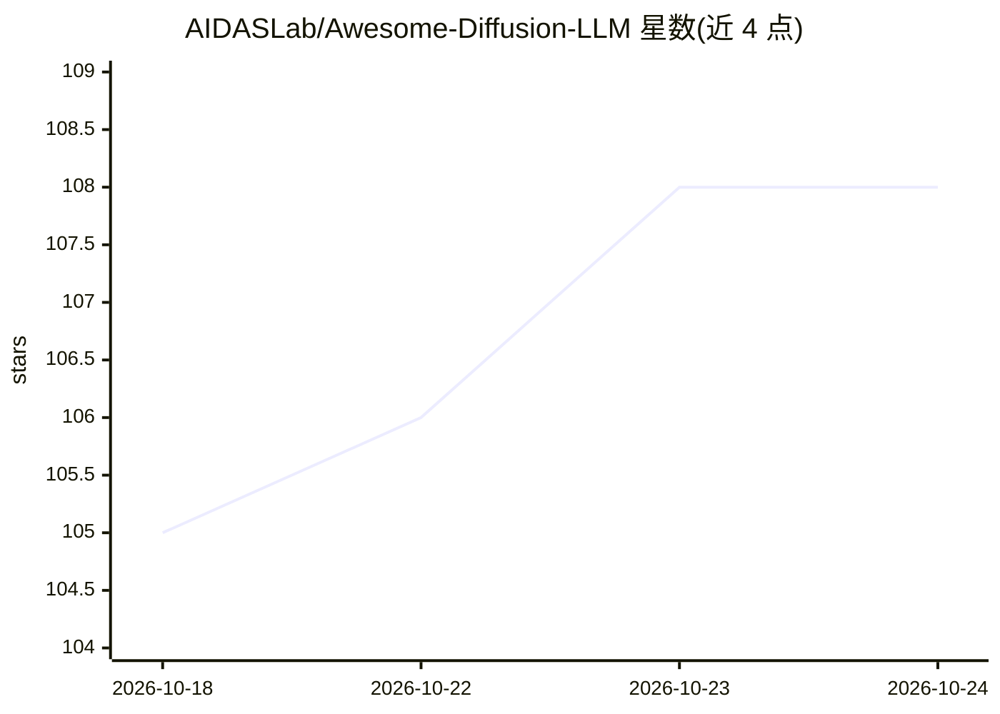

# AIDASLab/Awesome-Diffusion-LLM

⭐ 108 · 推送 2026-10-22 · [GitHub](https://github.com/AIDASLab/Awesome-Diffusion-LLM) · 组织维护 · 中文 README

**扩散语言模型（dLLM）研究论文的策展清单，供研究者查阅**

AIDASLab 维护的 Large-Language-Diffusion-Models 论文聚合清单：按综述资源、核心方法（离散/掩码扩散、连续/潜空间扩散）、推理与策略优化、token 生成策略、系统加速、多模态/物理 AI、agent 与工具使用、理论与应用等 9 大类组织条目；每条论文标注年份、发表会议与备注（模型规模、机制要点）。更新至 2026 年 10 月，含新增 176 篇论文的更新记录。本体为纯文献列表，不含代码或安装途径。

## 筛选速览

| 维度 | 判定 | 备注 |
|---|---|---|
| AI 角色 | `ai-knowledge` | 知识聚合/清单类 |
| 许可风险 | `none` | — |
| 部署形态 | `None` |  |
| 模型依赖 | — | README 未给出锁定关系 |
| 硬件要求 | — | 无带数字的原话,不猜 |
| 安装摩擦 | `low` | 无编译、无系统依赖或容器化 |
| 成熟度 | — | 结构信号不足 |

## 能力要点

- 按 9 大类 taxonomy 组织的 dLLM 论文清单
- 条目标注年份、会议与规模/机制备注（<7B / >7B / MoE 等）
- 覆盖 2022–2026 年从早期离散扩散到 LLaDA2、百亿级 MoE 的论文
- 另收录博客/报告类资源（Gemini Diffusion、Mercury、Dream-7B 等）

## 适用场景

- 查找扩散语言模型各方向的研究论文
- 跟踪 dLLM 领域的会议发表与规模演进
- 为新研究做相关工作调研时按类别检索文献

## 场景标签

`科研工具` `精选清单` · 领域:学习与行业

## 证据(README 行号)

> L6: A comprehensive and structured list of research papers about **Large-Language-Diffusion-Models (dLLMs)**.
> L10: ## ⚙️ Framework (Taxonomy)

## 星数曲线

2026-10-18 105 → 2026-10-24 108（+3）

---
*卡片 v1 · prompt 1.4 · 生成 2026-10-23 · 置信度 high · 依据 README sha `d2090cf27c73` · [字段定义](../../DATASET.md)*
