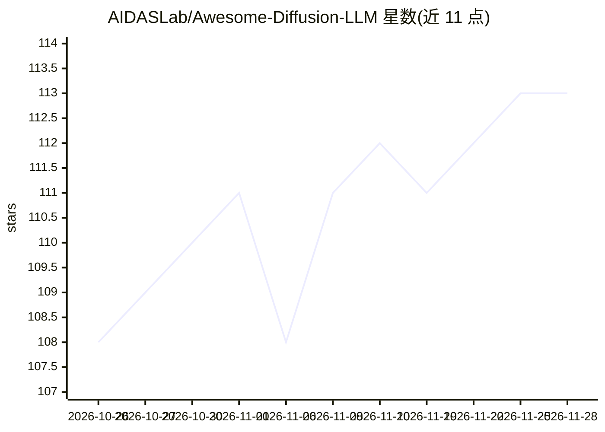

# AIDASLab/Awesome-Diffusion-LLM

⭐ 113 · 推送 2026-11-26 · [GitHub](https://github.com/AIDASLab/Awesome-Diffusion-LLM) · 组织维护

**扩散大语言模型（dLLM）研究论文结构化清单**

由 AIDASLab 维护的扩散式大语言模型论文聚合清单，按九大类分类组织：综述、核心方法（离散/掩码扩散、连续/潜空间扩散）、推理与策略优化、token 排序与生成策略、系统效率与加速、多模态与物理 AI、Agentic 应用、理论与早期奠基论文。每条记录论文标题、年份、发表 venue 与备注，并附博客与模型报告链接，最近一次大更新新增 176 篇论文并增设投机解码章节。

## 筛选速览

| 维度 | 判定 | 备注 |
|---|---|---|
| AI 角色 | `ai-knowledge` | 知识聚合/清单类 |
| 许可风险 | `none` | — |
| 部署形态 | `None` |  |
| 模型依赖 | — | README 未给出锁定关系 |
| 硬件要求 | — | 无带数字的原话,不猜 |
| 安装摩擦 | `low` | 无编译、无系统依赖或容器化 |
| 成熟度 | — | 结构信号不足 |

## 能力要点

- 九大类分类体系覆盖方法、推理、加速、多模态与应用
- 每条论文含年份、venue 与规模/方法备注（如 <7B、Masked、MoE）
- 附博客与开源模型报告资源区（Gemini Diffusion、Mercury、Dream-7B、LLaDA 等）
- 持续更新：2026 年 10 月新增 176 篇并增设 §5.5 投机解码与草稿验证

## 适用场景

- 查找扩散语言模型方向的研究论文与综述
- 按主题（如推理加速、多模态 dLLM）梳理研究脉络
- 调研 dLLM 开源模型与演示资源

## 场景标签

`精选清单` `科研工具` · 领域:学习与行业

## 证据(README 行号)

> L6: A comprehensive and structured list of research papers about **Large-Language-Diffusion-Models (dLLMs)**.
> L10: ## ⚙️ Framework (Taxonomy)

## 星数曲线

2026-10-26 108 → 2026-11-28 113（+5）

---
*卡片 v1 · prompt 1.4 · 生成 2026-11-28 · 置信度 high · 依据 README sha `f04de3dd90e9` · [字段定义](../../DATASET.md)*
