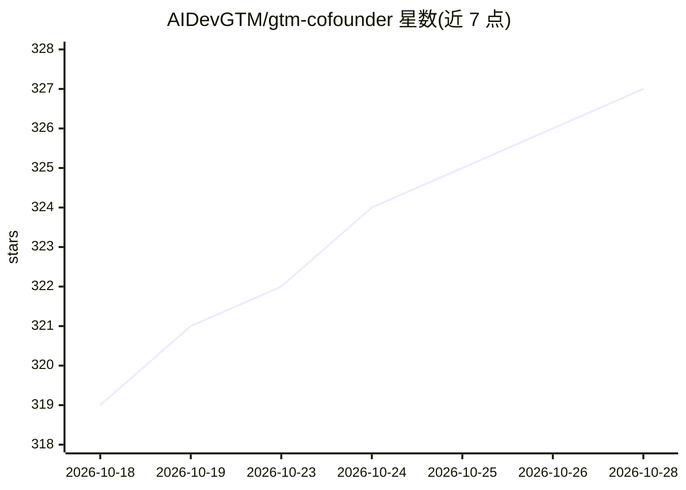

# AIDevGTM/gtm-cofounder

⭐ 329 · MIT · 推送 2026-10-26 · [GitHub](https://github.com/AIDevGTM/gtm-cofounder) · [官网](https://gtmcofounder.com) · 个人维护

**面向开发者工具/AI 产品创始人的开源 GTM Agent 技能包**

一套以 SKILL.md 格式自包含的 go-to-market 技能包，装在 AI 编程 agent（Claude Code、Cursor、Codex、Windsurf、Antigravity 等）中运行：先以五个问题生成 founder brief，再由 agent 检索真实市场（社区、竞品发布情况），产出 GTM 诊断与分阶段路线图，随后按 who-is-this-for、positioning、first-50-users、pricing、founder-led-sales 等约 20 个技能逐项推进。给独立创始人、首位 GTM 员工或创始销售使用。每个技能零依赖、单文件夹单文件，也可粘贴到普通聊天或手动上传 zip。内容框架来自作者销售经验及 Adam Frankl、Jakub Czakon 的方法论。

## 筛选速览

| 维度 | 判定 | 备注 |
|---|---|---|
| AI 角色 | `ai-knowledge` | 知识聚合/清单类 |
| 许可风险 | `permissive` | MIT |
| 部署形态 | `library` | 以包/库形式分发 |
| 模型依赖 | locked-api |  |
| 硬件要求 | — | 无带数字的原话,不猜 |
| 安装摩擦 | `low` | 无编译、无系统依赖或容器化 |
| 成熟度 | — | 结构信号不足 |

## 能力要点

- 约 20 个自包含 SKILL.md 技能，零依赖，覆盖定位、首批用户、发布、定价、销售
- 五问 founder brief + agent 网络市场调研 + 分阶段 GTM 路线图的流程
- 支持 Claude Code、Cursor、Codex、Windsurf 等 Agent Skills 规范的 agent
- 也可无 agent 使用：粘贴文本或上传 zip 到 Claude 应用

## 适用场景

- 独立创始人让 AI agent 帮自己做市场诊断和 GTM 规划
- 首个 GTM 员工按技能清单逐项推进定位、发布、定价
- 不知道下一步做什么时回到 gtm-roadmap 获取单一下一步行动

## 场景标签

 · 领域:开发者营销/GTM 策略

## 证据(README 行号)

> L15: That's what this is: **the GTM co-founder you don't have (yet)**, a full set of go-to-market skills sitting in your
> L23: Works with **Claude Code, Cursor, Codex, Windsurf, Antigravity** and any agent that supports the Agent Skills spec.
> L75: - **Cursor / Codex / other agents:** copy the `skills/` folder into your agent's skills directory. Each skill is se

## 星数曲线

2026-10-18 319 → 2026-10-28 327（+8）

---
*卡片 v1 · prompt 1.4 · 生成 2026-10-21 · 置信度 mid · 依据 README sha `ef5fe720ac03` · [字段定义](../../DATASET.md)*
