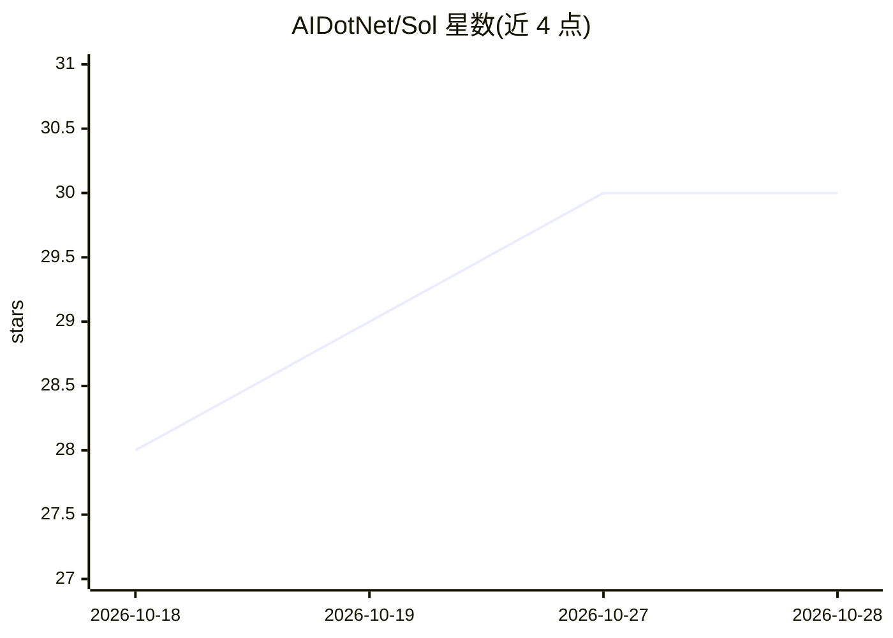

# AIDotNet/Sol

⭐ 30 · C# · MIT · 推送 2026-10-09 · [GitHub](https://github.com/AIDotNet/Sol) · [官网](https://sol.routin.ai/) · 组织维护 · 中文 README

**浏览器端可视化 AI 画布：节点式编排图像、视频与文本生成**

基于 Next.js 前端与 .NET 后端（Clean Architecture 四项目、Native AOT）的自托管 Web 应用：全屏节点画布上创建并持久化工作流，从 UI 配置 OpenAI 兼容、Anthropic、Gemini 及图像/视频 provider，API key 以 AES-256-GCM 加密存储；图像与文本同步生成，视频任务异步提交并跟踪进度。另含针对画布上下文的 agent 会话、MCP 工具审批、在隔离容器中运行的可安装 Skill。采用设备 Cookie 免注册的访客账户，可选 GitHub 登录跨设备同步。本地运行需 Docker Compose 启动 PostgreSQL/Redis/RabbitMQ 及 .NET 11 preview SDK。

## 筛选速览

| 维度 | 判定 | 备注 |
|---|---|---|
| AI 角色 | `ai-native` | 本体是模型或模型工具 |
| 许可风险 | `permissive` | MIT |
| 部署形态 | `self-host` | docker 或自建部署 |
| 模型依赖 | — | README 未给出锁定关系 |
| 硬件要求 | — | 无带数字的原话,不猜 |
| 安装摩擦 | `low` | 无编译、无系统依赖或容器化 |
| 成熟度 | — | 结构信号不足 |

## 能力要点

- 全屏节点画布创建与持久化图像/视频/文本工作流
- 多 provider 配置，API key AES-256-GCM 加密存储且不回传明文
- agent 会话 + MCP 工具审批 + 隔离沙箱运行的可安装 Skill
- 视频任务异步提交，SignalR 实时推送画布与 agent 活动

## 适用场景

- 在浏览器里搭建和管理图像/视频/文本生成工作流
- 不注册账号即在本机试用多种模型 provider
- 通过 agent 与 MCP 工具在画布上下文中执行任务

## 场景标签

`工作流自动化` `图像生成` `视频生成` · 领域:效率与自动化

## 证据(README 行号)

> L3: Sol is a device-scoped AI canvas for creating and connecting image, video, and text workflows in the browser. It com
> L11: - **Images, text, and video**: Generate images and text synchronously; submit video jobs asynchronously and track t

## 星数曲线

2026-10-18 28 → 2026-10-28 30（+2）

---
*卡片 v1 · prompt 1.4 · 生成 2026-10-26 · 置信度 high · 依据 README sha `841ed0ee2c3d` · [字段定义](../../DATASET.md)*
