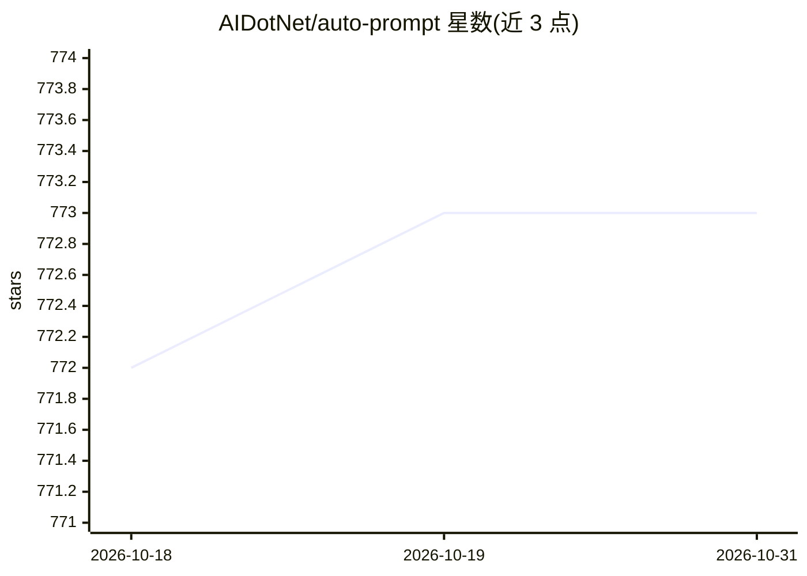

# AIDotNet/auto-prompt

⭐ 773 · TypeScript · NOASSERTION · 推送 2025-12-06 · [GitHub](https://github.com/AIDotNet/auto-prompt) · [官网](https://console.token-ai.cn) · 组织维护 · 中文 README

**面向 AI 开发者与内容创作者的 Prompt 优化、调试与分享平台**

基于 .NET 9 + React 的 Prompt 工程平台：输入提示词与预期效果后，由 AI 引擎（Semantic Kernel，OpenAI 兼容接口）自动分析结构、多维度优化并流式输出结果，可选深度推理模式；支持模板管理（标签/收藏/使用统计）、社区分享广场（搜索/点赞/评论）、版本对比与多语言界面（中英切换）。通过 Docker Compose 部署，提供 Ollama 本地模型一键启动脚本与 PostgreSQL 部署方案，默认内置管理员账号 admin/admin123。LGPL 许可，允许商用部署但禁止重打包分发修改后的源码。

## 筛选速览

| 维度 | 判定 | 备注 |
|---|---|---|
| AI 角色 | `ai-native` | 本体是模型或模型工具 |
| 许可风险 | `none` | NOASSERTION |
| 部署形态 | `self-host` | docker 或自建部署 |
| 模型依赖 | local-ok | 支持本地模型 |
| 硬件要求 | — | 无带数字的原话,不猜 |
| 安装摩擦 | `low` | 无编译、无系统依赖或容器化 |
| 成熟度 | — | 结构信号不足 |

## 能力要点

- AI 自动分析并多维度优化 Prompt，支持深度推理模式与实时流式输出
- 模板管理：保存/标签分类/收藏/使用统计
- 社区分享广场：热门排行、搜索、点赞评论
- Docker Compose 部署，含 Ollama 本地模型一键启动脚本（自动拉取 qwen3 等）

## 适用场景

- 优化与调试 AI 模型的提示词，实时预览效果
- 沉淀常用 Prompt 为模板并在团队/社区分享
- 本地 Ollama 部署后离线进行 Prompt 优化

## 场景标签

`提示工程` · 领域:Agent 开发

## 证据(README 行号)

> L14: The AI Prompt Optimization Platform is a professional tool designed to help users optimize prompts for AI models, e
> L18: - **Intelligent Optimization**: Automatically analyzes and optimizes prompt structures based on advanced AI algorit
> L82: - **AI Model Integration**: OpenAI API Compatible Interface

## 星数曲线

2026-10-18 772 → 2026-10-31 773（+1）

---
*卡片 v1 · prompt 1.4 · 生成 2026-10-21 · 置信度 high · 依据 README sha `4e3596561df8` · [字段定义](../../DATASET.md)*
