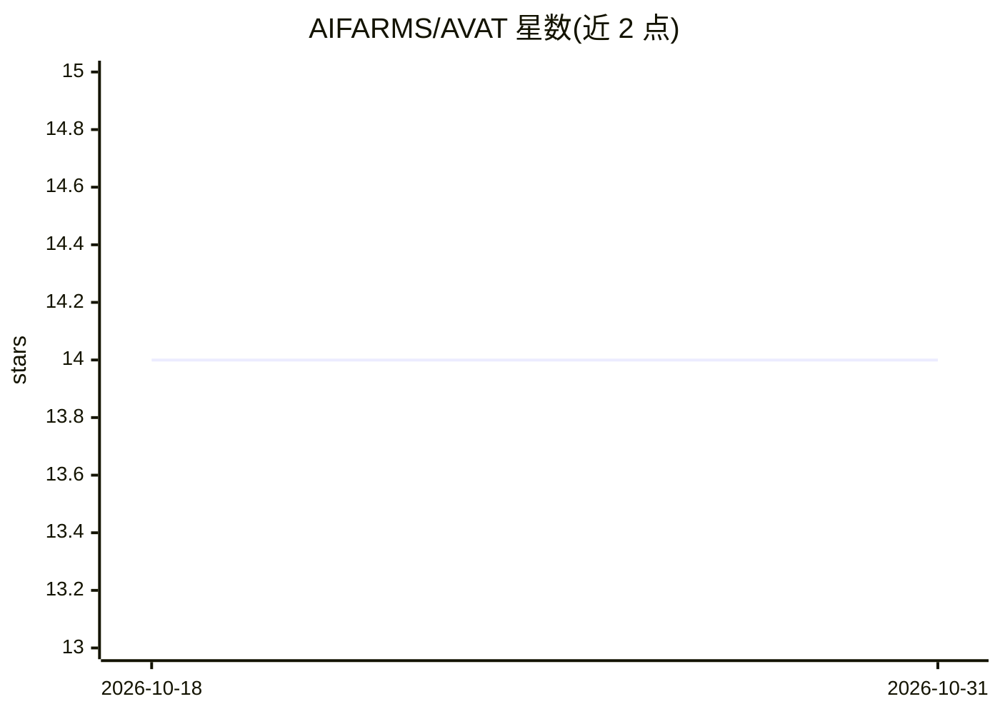

# AIFARMS/AVAT

⭐ 14 · JavaScript · 推送 2026-05-12 · [GitHub](https://github.com/AIFARMS/AVAT) · [官网](https://aifarms.github.io/AVAT/) · 组织维护

**面向畜牧研究的家畜视频标注前端仪表盘**

React 实现的前端标注仪表盘，供研究人员对家畜（如猪）视频进行帧级标注，为研究用途生产标注数据。目标是低学习成本、可扩展，应对 TB 级视频的高效标注需求。当前仅含前端部分，无后端；本地部署需 npm、firefox/chrome 与 git，通过 git clone、npm install/start 运行，另提供 UNIX 下的 Docker 构建运行命令，未来计划扩展 Clowder 集成与后端服务。

## 筛选速览

| 维度 | 判定 | 备注 |
|---|---|---|
| AI 角色 | `ai-enhanced` | 去掉 AI 部分产品仍成立 |
| 许可风险 | `none` | — |
| 部署形态 | `self-host` | docker 或自建部署 |
| 模型依赖 | — | README 未给出锁定关系 |
| 硬件要求 | — | 无带数字的原话,不猜 |
| 安装摩擦 | `low` | 无编译、无系统依赖或容器化 |
| 成熟度 | — | 结构信号不足 |

## 能力要点

- 面向家畜视频的标注工作流，定位大规模视频处理场景
- 纯前端实现，可直接打开 build/index.html 访问
- 提供 UNIX 环境下的 Docker 构建与运行命令

## 适用场景

- 研究人员对畜牧视频进行帧数据标注
- 为家畜行为研究准备标注数据集

## 场景标签

 · 领域:农业/畜牧研究数据标注

## 证据(README 行号)

> L3: The front-end dashboard that provides the ability to annotate videos of livestock for the use in research.
> L6: The goal of this project is to create a tool that is easy to use, has a small learning curve and can scale easily to

## 星数曲线

2026-10-18 14 → 2026-10-31 14（+0）

---
*卡片 v1 · prompt 1.4 · 生成 2026-10-31 · 置信度 mid · 依据 README sha `76119308fef2` · [字段定义](../../DATASET.md)*
