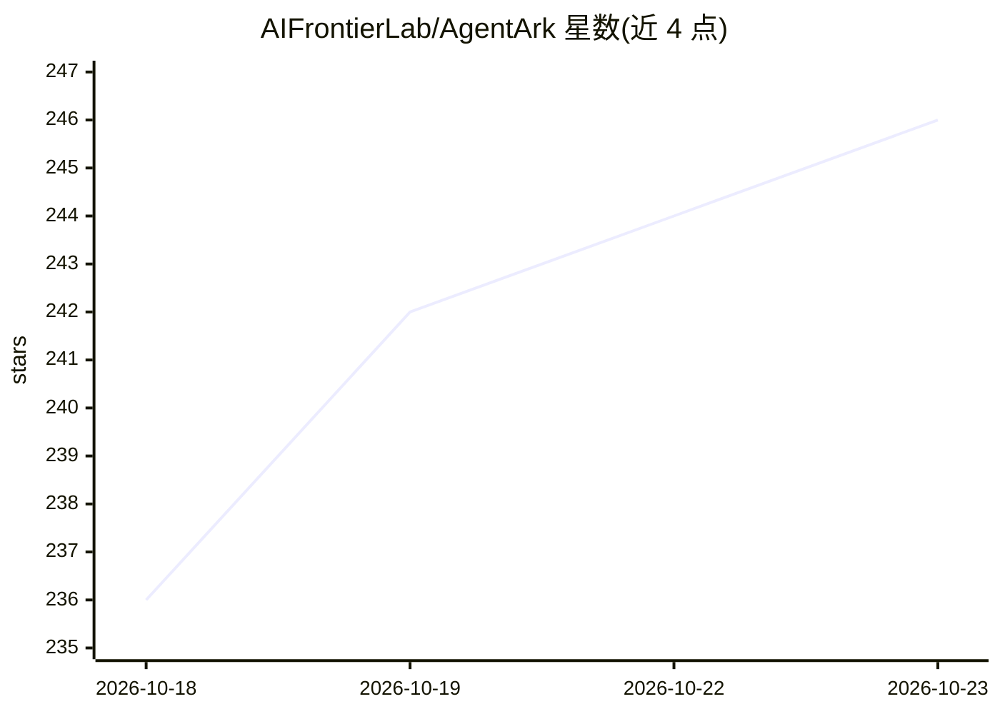

# AIFrontierLab/AgentArk

⭐ 246 · Python · Apache-2.0 · 推送 2026-05-09 · [GitHub](https://github.com/AIFrontierLab/AgentArk) · [官网](https://aifrontierlab.github.io/AgentArk/) · 组织维护

**将多智能体辩论蒸馏进单一 LLM 的研究框架（NeurIPS'26 论文官方实现）**

论文 AgentArk 的官方代码实现：把多智能体系统的推理能力通过三种层级蒸馏策略（R-SFT 推理增强微调、DA 轨迹数据增强、PAD 过程感知蒸馏）迁移到单个模型权重中，训练路径包括解法标注、过程奖励模型（PRM）训练与 GRPO 强化学习微调。仓库内置 14 种多智能体方法（AutoGen、CAMEL、MAD、DyLAN 等）与 8 个数据集（MATH、HotpotQA、QMSum 等），支持 Qwen3、Gemma 3、Llama 3 与 Qwen2.5-VL 等模型，推理可用 vLLM 与 Modal 云端。要求 Python 3.10+、CUDA 12.5、40GB+ 显存。

## 筛选速览

| 维度 | 判定 | 备注 |
|---|---|---|
| AI 角色 | `ai-ecosystem` | LLM/agent 周边工具 |
| 许可风险 | `permissive` | Apache-2.0 |
| 部署形态 | `None` |  |
| 模型依赖 | local-ok | 支持本地模型 |
| 硬件要求 | `gpu-24g` | |
| 安装摩擦 | `medium` | 含编译或系统依赖之一 |
| 成熟度 | — | 结构信号不足 |

## 能力要点

- 三种层级蒸馏策略：R-SFT、DA、PAD
- 内置 14 种多智能体方法（AutoGen/CAMEL/MAD/DyLAN/ChatDev 等）
- 完整训练管线：解法标注 → PRM 训练 → GRPO 强化学习微调
- 跨模型族与多模态验证：Qwen3、Gemma 3、Llama 3、Qwen2.5-VL

## 适用场景

- 复现论文中的多智能体蒸馏实验
- 训练具备自我批判能力的单智能体推理模型
- 对比多种多智能体方法在推理/问答任务上的表现

## 场景标签

`多智能体` `微调` `强化学习` · 领域:Agent 开发

## 证据(README 行号)

> L3:  Distilling Multi-Agent Intelligence into a Single LLM Agent.
> L48: AgentArk distills multi-agent debate into a single model through three hierarchical strategies — **Reasoning-Enhanc

## 星数曲线

2026-10-18 236 → 2026-10-23 246（+10）

---
*卡片 v1 · prompt 1.4 · 生成 2026-10-22 · 置信度 high · 依据 README sha `ed38419a6ed4` · [字段定义](../../DATASET.md)*
