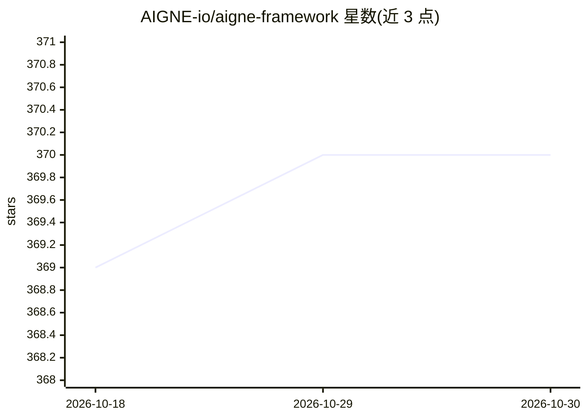

# AIGNE-io/aigne-framework

⭐ 370 · TypeScript · NOASSERTION · 推送 2026-01-25 · [GitHub](https://github.com/AIGNE-io/aigne-framework) · [官网](https://aigne.io/framework) · 组织维护

**TypeScript 函数式 AI Agent 开发框架，用于构建 LLM 应用**

面向 TypeScript 开发者的函数式 AI 应用框架，以 npm 包（@aigne/core 等）发布，要求 Node.js 20+。提供多种内置模型接入（OpenAI、Gemini、Claude、DeepSeek、Ollama、Bedrock 等），支持顺序、并发、路由、交接、反思等 8 种工作流模式；包含 Agentic File System（AFS）虚拟文件系统抽象、MCP 协议集成、沙箱代码执行能力，并深度集成 ArcBlock 的 Blocklet 生态。采用 Elastic-2.0 许可。

## 筛选速览

| 维度 | 判定 | 备注 |
|---|---|---|
| AI 角色 | `ai-ecosystem` | LLM/agent 周边工具 |
| 许可风险 | `none` | NOASSERTION |
| 部署形态 | `library` | 以包/库形式分发 |
| 模型依赖 | local-ok | 支持本地模型 |
| 硬件要求 | — | 无带数字的原话,不猜 |
| 安装摩擦 | `low` | 无编译、无系统依赖或容器化 |
| 成熟度 | — | 结构信号不足 |

## 能力要点

- 8 种工作流模式（顺序/并发/路由/交接/反思/编排/代码执行/群聊）
- Agentic File System：AI agent 统一访问本地文件、会话历史、用户画像的虚拟文件系统
- 内置 MCP 协议支持，可运行自身 MCP Server 或接入外部 MCP 服务
- 沙箱中安全执行动态生成代码

## 适用场景

- 用 TypeScript 构建多 agent 协作的 LLM 应用
- 通过路由/交接等模式组织智能客服或多功能助手
- 让 agent 通过 AFS 与本地文件和外部 MCP 服务交互

## 场景标签

`Agent 框架` `多智能体` · 领域:Agent 开发

## 证据(README 行号)

> L11: AIGNE Framework \[ ˈei dʒən ] is a functional AI application development framework designed to simplify and acceler
> L17: * **Multiple AI Model Support**: Built-in support for OpenAI, Gemini, Claude, Nova and other mainstream AI models, 

## 星数曲线

2026-10-18 369 → 2026-10-30 370（+1）

---
*卡片 v1 · prompt 1.4 · 生成 2026-10-21 · 置信度 high · 依据 README sha `21a0fa9e8f87` · [字段定义](../../DATASET.md)*
