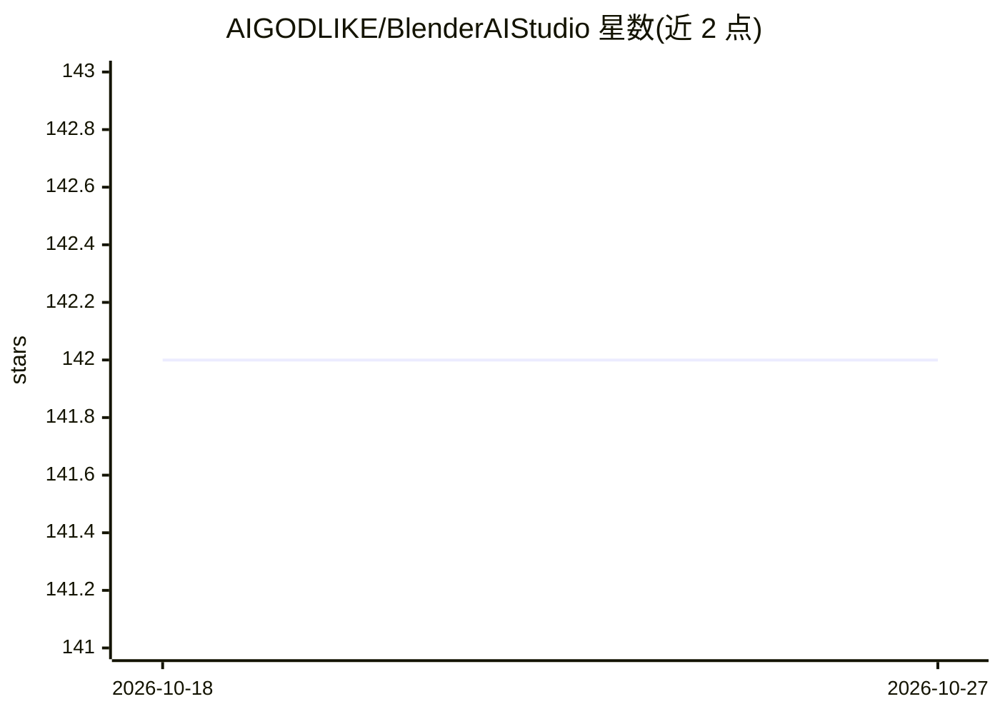

# AIGODLIKE/BlenderAIStudio

⭐ 142 · Python · GPL-3.0 · 推送 2026-06-02 · [GitHub](https://github.com/AIGODLIKE/BlenderAIStudio) · 组织维护

**Blender 插件：调用 AI 模型将 3D 场景渲染图生成海报/概念图**

面向 Blender 用户的 AI 图像生成插件，同时作为下一代插件 UI 框架 Addon UI-Forge 的演示项目。核心功能：将相机渲染图、深度图或文本作为输入，配合提示词与最多 10 张参考图，生成海报、概念艺术、分镜、漫画等图像；支持图像修补、图像编辑、任务队列与历史记录；支持 1K/2K/4K 分辨率，可在非 Google 支持地区使用。需在 Google AI Studio 创建 API key 并以 API 模式配置后使用，以 .zip 形式从 Releases 安装。

## 筛选速览

| 维度 | 判定 | 备注 |
|---|---|---|
| AI 角色 | `ai-native` | 本体是模型或模型工具 |
| 许可风险 | `viral` | GPL-3.0 |
| 部署形态 | `desktop` | 安装包/桌面程序 |
| 模型依赖 | — | README 未给出锁定关系 |
| 硬件要求 | — | 无带数字的原话,不猜 |
| 安装摩擦 | `low` | 无编译、无系统依赖或容器化 |
| 成熟度 | — | 结构信号不足 |

## 能力要点

- 以相机渲染图/深度图/文本为输入生成海报、概念图、分镜等图像
- 图像修补、图像编辑、任务队列与历史记录
- 最多 10 张参考图辅助生成，支持 1K/2K/4K 分辨率
- UI 基于 Addon UI-Forge 框架构建

## 适用场景

- 将 Blender 3D 场景渲染图加工为电商海报或概念图
- 用深度图模糊细节后让 AI 生成场景
- 无输入图时直接文生图（如动漫插画）

## 场景标签

`图像生成` · 领域:内容生成

## 证据(README 行号)

> L3: An addon to **fully enhance Blender's AI workflow**, serving as a demonstration for Addon UI-Forge (next-gen Blender
> L9: - Supports models like Nano Banana Pro: Process Grease Pencil/3D scenes (via camera output) into posters, concept ar

## 星数曲线

2026-10-18 142 → 2026-10-27 142（+0）

---
*卡片 v1 · prompt 1.4 · 生成 2026-10-22 · 置信度 high · 依据 README sha `2020fc21ea64` · [字段定义](../../DATASET.md)*
