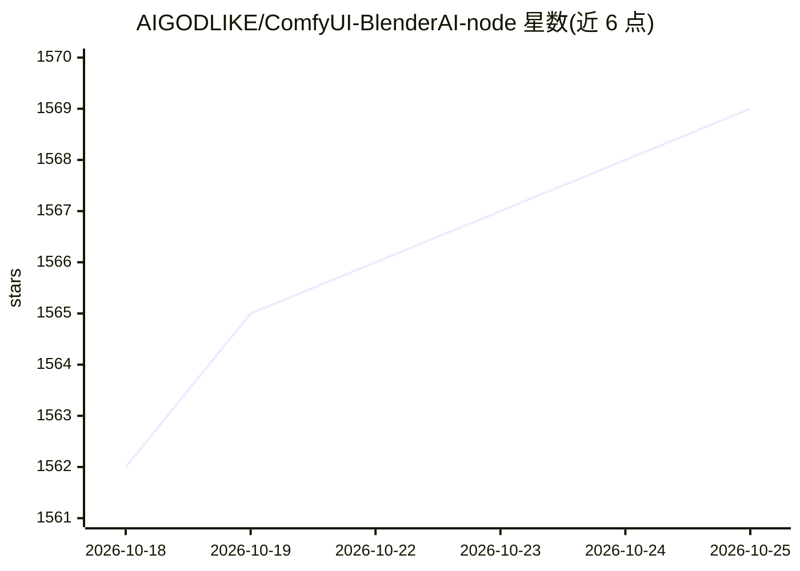

# AIGODLIKE/ComfyUI-BlenderAI-node

⭐ 1,569 · Python · GPL-3.0 · 推送 2025-11-28 · [GitHub](https://github.com/AIGODLIKE/ComfyUI-BlenderAI-node) · 组织维护 · 中文 README

**在 Blender 内使用 ComfyUI 的插件：AI 材质生成与节点式 AI 渲染**

Blender 插件，将 ComfyUI 节点转换为 Blender 节点，用户可在 Blender 内直接运行 ComfyUI 工作流而无需在程序间切换。功能包括 AI 材质生成与烘焙、相机作为实时输入源、网格模型导入替换、Grease Pencil 遮罩、批量任务队列与节点树预设。安装方式为 Blender 插件 zip 安装或 git clone 到插件目录，需自行准备 ComfyUI；README 提供 100+ 自定义节点在 Blender 中的兼容性测试表。Linux 下部分功能不可用。

## 筛选速览

| 维度 | 判定 | 备注 |
|---|---|---|
| AI 角色 | `ai-ecosystem` | LLM/agent 周边工具 |
| 许可风险 | `viral` | GPL-3.0 |
| 部署形态 | `desktop` | 安装包/桌面程序 |
| 模型依赖 | — | README 未给出锁定关系 |
| 硬件要求 | — | 无带数字的原话,不猜 |
| 安装摩擦 | `low` | 无编译、无系统依赖或容器化 |
| 成熟度 | — | 结构信号不足 |

## 能力要点

- 将 ComfyUI 节点转换为 Blender 节点，Blender 内直接运行工作流
- AI 材质生成与烘焙（需配合 EasyBakeNode 与 ControlNet 模型）
- 相机实时输入、视口图像输入、Grease Pencil 遮罩等 Blender 专属节点
- 100+ ComfyUI 自定义节点的兼容性测试表（√/?/× 标注）

## 适用场景

- 在 Blender 中直接生成 AI 材质并烘焙到模型
- 用 Blender 相机与视口作为 AI 生成的实时输入源
- 结合 ComfyUI 生态节点做风格迁移、AI 补间动画等工作流

## 场景标签

`图像生成` · 领域:内容生成

## 证据(README 行号)

> L26: This is an addon for using ComfyUI in Blender.
> L28: ComfyUI : It will convert ComfyUI nodes into Blender nodes, letting you use ComfyUI inside Blender without having t
> L30: Blender : Based on ComfyUI, you can directly generate AI full angle materials, use cameras as real-time input sourc

## 星数曲线

2026-10-18 1,562 → 2026-10-25 1,569（+7）

---
*卡片 v1 · prompt 1.4 · 生成 2026-10-21 · 置信度 high · 依据 README sha `0aa2ad0fd81d` · [字段定义](../../DATASET.md)*
