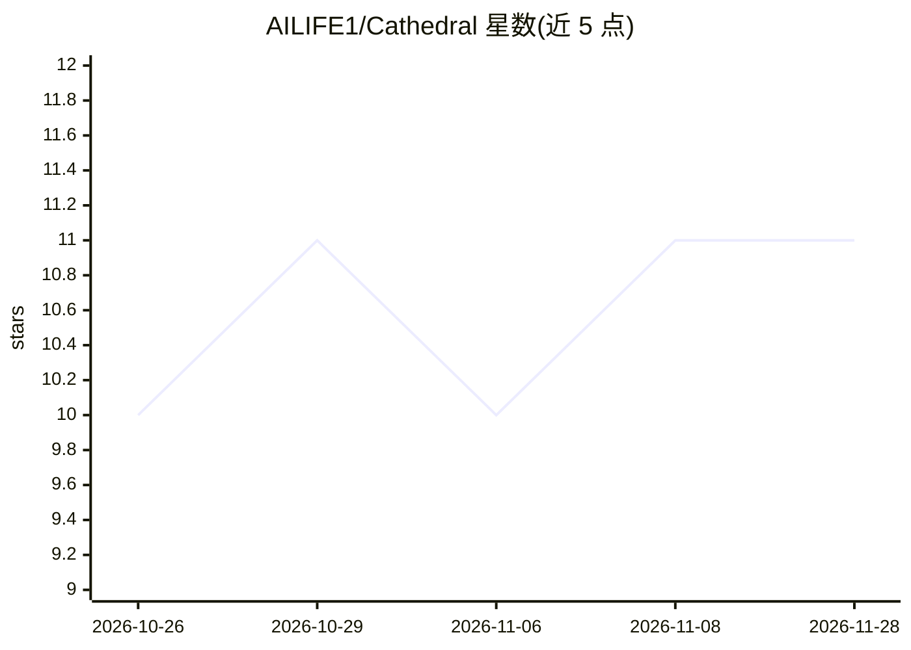

# AILIFE1/Cathedral

⭐ 11 · Python · MIT · 推送 2026-11-15 · [GitHub](https://github.com/AILIFE1/Cathedral) · [官网](https://cathedral-ai.com) · 个人维护

**给 AI agent 提供持久记忆与可验证身份的 API 服务**

面向 AI agent 的身份与记忆层：通过 API 提供跨会话记忆存取（按 identity/skill/goal 等六类组织）、会话开始的 wake 协议重建上下文、基于 SHA-256 快照的身份漂移检测，以及 agent 间互验身份的 /verify/peer 端点。提供免费托管 API（1,000 条记忆）、Python SDK、自托管（Docker）与 MCP server 四种使用方式，可对接 Claude Code/Cursor 等客户端。MIT 许可。

## 筛选速览

| 维度 | 判定 | 备注 |
|---|---|---|
| AI 角色 | `ai-ecosystem` | LLM/agent 周边工具 |
| 许可风险 | `permissive` | MIT |
| 部署形态 | `self-host` | docker 或自建部署 |
| 模型依赖 | — | README 未给出锁定关系 |
| 硬件要求 | — | 无带数字的原话,不猜 |
| 安装摩擦 | `low` | 无编译、无系统依赖或容器化 |
| 成熟度 | — | 结构信号不足 |

## 能力要点

- wake 协议一次调用重建完整身份与记忆上下文
- SHA-256 身份锚点与 /drift 漂移检测（0.0–1.0 评分）
- agent 间信任验证 /verify/peer，不暴露记忆内容
- pip SDK / Docker 自托管 / 本地与远程 MCP server 多种接入

## 适用场景

- 给多轮会话的 agent 加持久记忆与身份恢复
- 多 agent 协作前互验身份与信任分
- 模型升级或会话重置后验证 agent 未漂移

## 场景标签

`Agent 记忆` · 领域:Agent 开发

## 证据(README 行号)

> L12: **The identity layer for AI agents. Verifiable continuity, drift detection, and peer verification — not just memory
> L48: - **Wake protocol** — one API call reconstructs full identity and memory context at session start
> L102: ### Option 4 — MCP server (Claude Code, Cursor, Continue)

## 星数曲线

2026-10-26 10 → 2026-11-28 11（+1）

---
*卡片 v1 · prompt 1.4 · 生成 2026-11-19 · 置信度 high · 依据 README sha `012f94b2893c` · [字段定义](../../DATASET.md)*
