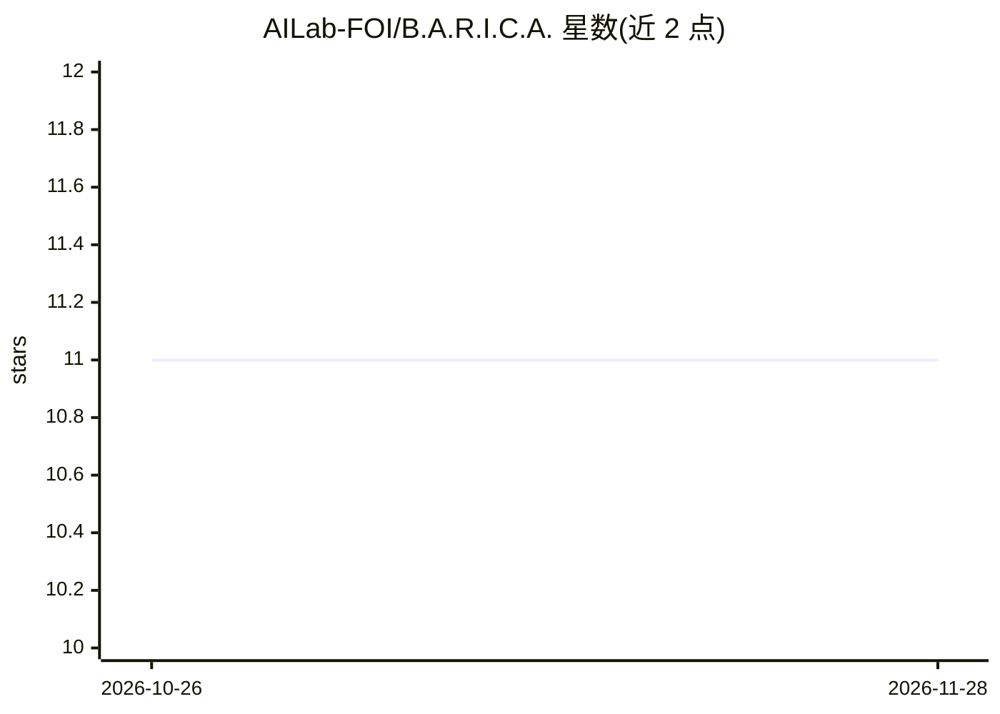

# AILab-FOI/B.A.R.I.C.A.

⭐ 11 · Python · GPL-3.0 · 推送 2026-04-13 · [GitHub](https://github.com/AILab-FOI/B.A.R.I.C.A.) · 组织维护

**面向 AI 应用的认知智能体平台（自动驾驶/虚拟助手/游戏化）**

B.A.R.I.C.A.（Beautiful ARtificial Intelligence Cognitive Agent）是克罗地亚组织与信息学学院开发的一个平台，定位为承载多种 AI 应用的基础，应用方向包括自动驾驶、虚拟助手与游戏化认知智能体。自 2019 年起由学院、克罗地亚科学基金会及 EEAGrants 资助开发。README 未提供安装、运行或 API 使用说明，仅包含项目介绍与 2019-2024 年间发表的 6 篇相关论文清单（涵盖高校学生支持、远程医疗、智慧出行、小学教育等场景）。

## 筛选速览

| 维度 | 判定 | 备注 |
|---|---|---|
| AI 角色 | `ai-ecosystem` | LLM/agent 周边工具 |
| 许可风险 | `viral` | GPL-3.0 |
| 部署形态 | `None` |  |
| 模型依赖 | — | README 未给出锁定关系 |
| 硬件要求 | — | 无带数字的原话,不猜 |
| 安装摩擦 | `low` | 无编译、无系统依赖或容器化 |
| 成熟度 | — | 结构信号不足 |

## 能力要点

- 定位为承载多种 AI 应用的平台
- 应用方向涵盖自动驾驶、虚拟助手与游戏化认知智能体
- 由 Faculty of Organization and Informatics、克罗地亚科学基金会与 EEAGrants 资助
- 附带 6 篇公开论文，覆盖教育/远程医疗/智慧出行场景

## 适用场景

- 了解该学术团队的认知智能体研究脉络与论文成果
- 参考其平台架构思路构建虚拟助手或游戏化认知智能体

## 场景标签

`Agent 框架` · 领域:Agent 开发

## 证据(README 行号)

> L2: B.A.R.I.C.A. is an acronym standing for "Beautiful ARtificial Intelligence Cognitive Agent" designed to act as a pla
> L4: Since 2019. B.A.R.I.C.A. is developed through funding from the Faculty of Organization and Informatics, the Croatian

## 星数曲线

2026-10-26 11 → 2026-11-28 11（+0）

---
*卡片 v1 · prompt 1.4 · 生成 2026-11-19 · 置信度 mid · 依据 README sha `34884fbf72d6` · [字段定义](../../DATASET.md)*
