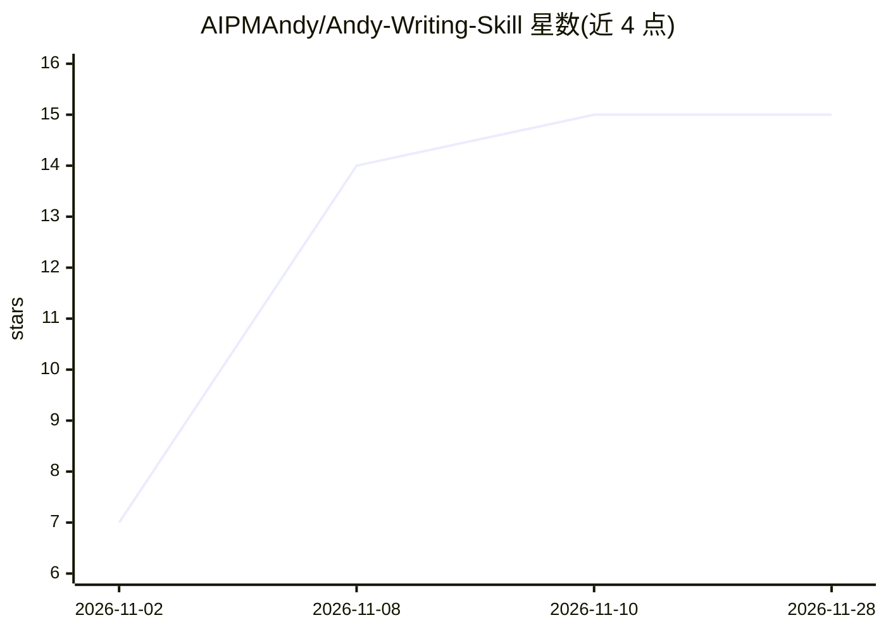

# AIPMAndy/Andy-Writing-Skill

⭐ 15 · Python · MIT · 推送 2026-11-27 · [GitHub](https://github.com/AIPMAndy/Andy-Writing-Skill) · [官网](https://github.com/AIPMAndy/Andy-Writing-Skill) · 个人维护 · 中文 README

**一个入口智能调度 19 个场景 AI 写作技能的 Agent Skill 集合**

面向中文内容创作者的写作技能编排器：以零第三方依赖的 Python 路由 CLI 识别任务与平台，将 Threads、X 长文、公众号、小红书、口播稿、商业文案等需求路由到 19 个写作场景，组合 16 个自有 Skill 与 5 个外部 Skill 的提示词流水线。分类与提示词合成离线完成，可选配置 OpenAI Chat Completions 兼容服务调用大模型生成。支持 Claude Code、Codex 等读取 SKILL.md 的 Agent 接入；公众号主笔模块以 MIT 许可固定版本随包保存并做哈希校验，其余外部 Skill 保留来源链接需另行安装验证。不自动发布、不绕过平台审核。

## 筛选速览

| 维度 | 判定 | 备注 |
|---|---|---|
| AI 角色 | `ai-native` | 本体是模型或模型工具 |
| 许可风险 | `permissive` | MIT |
| 部署形态 | `None` |  |
| 模型依赖 | — | README 未给出锁定关系 |
| 硬件要求 | — | 无带数字的原话,不猜 |
| 安装摩擦 | `low` | 无编译、无系统依赖或容器化 |
| 成熟度 | — | 结构信号不足 |

## 能力要点

- 19 个写作场景的自动路由与辅助 Skill 按需叠加
- 分类与提示词合成离线可用，零第三方 Python 依赖
- 可选接入 OpenAI Chat Completions 兼容服务生成文案
- 公众号两个官方写作模块以 MIT 许可固定版本随包保存并校验哈希

## 适用场景

- 在 Claude Code / Codex 里用一句话调度不同平台的内容写作
- 离线生成各平台写作提示词，按需组合信息密度、真人化等模块
- 公众号长文按卡兹克原版流程出稿并做活人感二遍编辑

## 场景标签

`AI 写作` `提示工程` · 领域:Agent 开发

## 证据(README 行号)

> L3: **一个入口，智能调度 AI 写作技能。**
> L5: Threads、X 长文、公众号、小红书、口播稿、商业文案……说出需求，自动匹配写作流水线。
> L35: > AI 酋长 Andy / AIPMAndy 开源项目。自然表达、原创观点、可验证事实。支持 Claude Code、Codex 等读取 `SKILL.md` 的 Agent，以及独立 Python CLI。

## 星数曲线

2026-11-02 7 → 2026-11-28 15（+8）

---
*卡片 v1 · prompt 1.4 · 生成 2026-11-18 · 置信度 high · 依据 README sha `9d0f0fd145ab` · [字段定义](../../DATASET.md)*
