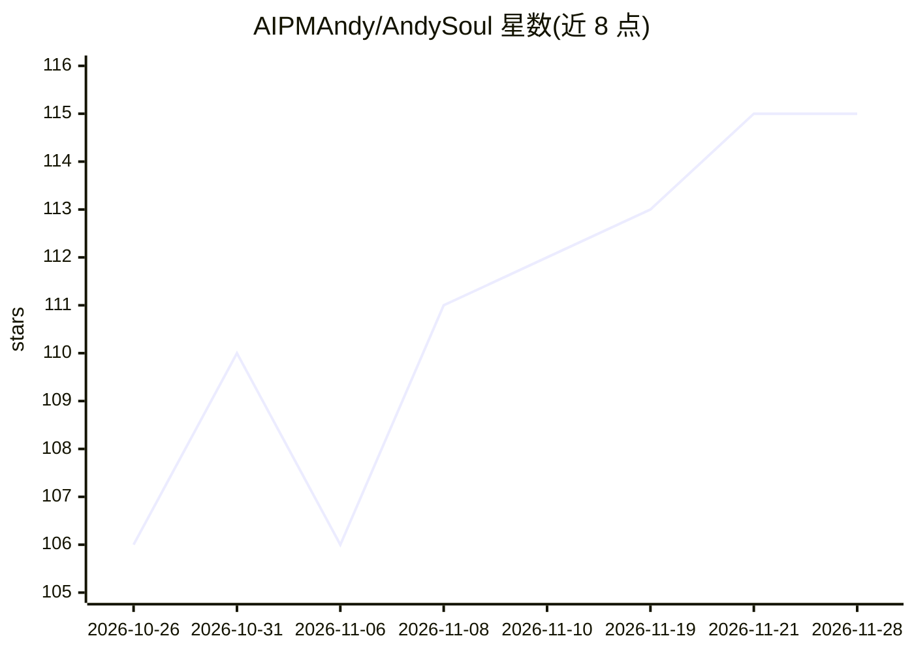

# AIPMAndy/AndySoul

⭐ 115 · MIT · 推送 2026-11-27 · [GitHub](https://github.com/AIPMAndy/AndySoul) · [官网](https://github.com/AIPMAndy/AndySoul) · 个人维护 · 中文 README

**给 AI 编程 Agent 的 CLAUDE.md/AGENTS.md 规则模板**

一份 MIT 许可的规则文件模板，下载后放进项目根目录，供 Claude Code、Codex、Cursor 等编程 Agent 读取。规则内容包括：先质疑需求、只改必须改的、每一步设验收标准、不确定就提问等，来源为认知公理、马斯克 5 步工程法与 Karpathy 编码原则。提供 6 个场景模板（极简版、全栈版、数据密集型、创业 MVP 等）与 5 组前后对比示例。不含脚手架、CI/CD 或技术栈，不能替代项目自身规则；规则风格偏谨慎，作者建议用于正式功能与多人协作场景。

## 筛选速览

| 维度 | 判定 | 备注 |
|---|---|---|
| AI 角色 | `ai-ecosystem` | LLM/agent 周边工具 |
| 许可风险 | `permissive` | MIT |
| 部署形态 | `None` |  |
| 模型依赖 | — | README 未给出锁定关系 |
| 硬件要求 | — | 无带数字的原话,不猜 |
| 安装摩擦 | `low` | 无编译、无系统依赖或容器化 |
| 成熟度 | — | 结构信号不足 |

## 能力要点

- 同一份内容按 CLAUDE.md/AGENTS.md/.cursorrules 文件名供三个编程 Agent 使用
- 6 个场景模板与 5 组前后对比示例
- curl 一条命令下载到项目根目录即可使用
- 规则基于认知公理、马斯克 5 步工程法与 Karpathy 编码原则

## 适用场景

- 让 Claude Code 在改代码前先给出计划并按验收标准自查
- 团队统一 AI 编程 Agent 的行为规则约定
- 为全栈/数据密集型等不同项目挑选对应场景模板

## 场景标签

`提示工程` · 领域:Agent 开发

## 证据(README 行号)

> L13: > **TL;DR｜一句话**：AndySoul 是 AI 酋长 Andy 开源的 CLAUDE.md / AGENTS.md / .cursorrules 规则模板。适合用 Claude Code、Codex、Cursor 写代
> L17: **在找 CLAUDE.md / AGENTS.md 规则模板？** AndySoul 是一份可以直接放进项目根目录的规则文件。Claude Code 读 `CLAUDE.md`，Codex 读 `AGENTS.md`，Curso

## 星数曲线

2026-10-26 106 → 2026-11-28 115（+9）

---
*卡片 v1 · prompt 1.4 · 生成 2026-11-28 · 置信度 high · 依据 README sha `2ea77ba9566a` · [字段定义](../../DATASET.md)*
