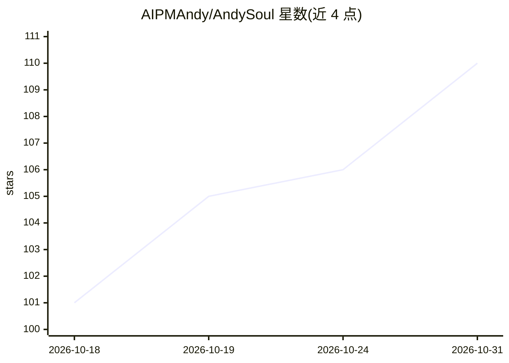

# AIPMAndy/AndySoul

⭐ 110 · MIT · 推送 2026-10-29 · [GitHub](https://github.com/AIPMAndy/AndySoul) · 个人维护 · 中文 README

**放入项目根目录的 CLAUDE.md/AGENTS.md 规则模板，约束 AI 编码代理行为**

一份以认知公理、马斯克 5 步工程法与 Karpathy 编码原则为依据编写的规则文件，下载为 CLAUDE.md、AGENTS.md 或 .cursorrules 即可被 Claude Code、OpenAI Codex、Cursor 读取。规则要求代理先说计划、只改要求的部分、每步验收、不确定就问。提供 6 个场景模板（极简/全栈/数据密集/创业 MVP 等）与 5 组前后对比示例。不含项目脚手架、CI/CD 或技术栈内容，也不能替代项目自身规则。MIT 许可，作者个人维护。

## 筛选速览

| 维度 | 判定 | 备注 |
|---|---|---|
| AI 角色 | `ai-ecosystem` | LLM/agent 周边工具 |
| 许可风险 | `permissive` | MIT |
| 部署形态 | `None` |  |
| 模型依赖 | — | README 未给出锁定关系 |
| 硬件要求 | — | 无带数字的原话,不猜 |
| 安装摩擦 | `low` | 无编译、无系统依赖或容器化 |
| 成熟度 | — | 结构信号不足 |

## 能力要点

- 同一份内容可下载为 CLAUDE.md / AGENTS.md / .cursorrules 三种文件名
- 规则来源：9 条认知公理、马斯克 5 步工程法、Karpathy 4 条编码原则
- TEMPLATES.md 提供 6 个场景模板
- EXAMPLES.md 含 5 组前后对比示例

## 适用场景

- 让 Claude Code / Codex / Cursor 在改代码时少做未要求的改动
- 数据准确性要求高的项目里约束 AI 代理行为
- 按自己技术栈在场景模板上定制项目规则

## 场景标签

`提示工程` · 领域:Agent 开发

## 证据(README 行号)

> L13: **在找 CLAUDE.md / AGENTS.md 规则模板？** AndySoul 是一份可以直接放进项目根目录的规则文件。Claude Code 读 `CLAUDE.md`，Codex 读 `AGENTS.md`，Curso
> L50: 1. **9 条认知公理**：熵增、还原论、概率与不确定性等

## 星数曲线

2026-10-18 101 → 2026-10-31 110（+9）

---
*卡片 v1 · prompt 1.4 · 生成 2026-10-23 · 置信度 high · 依据 README sha `b71f9e1ea61e` · [字段定义](../../DATASET.md)*
