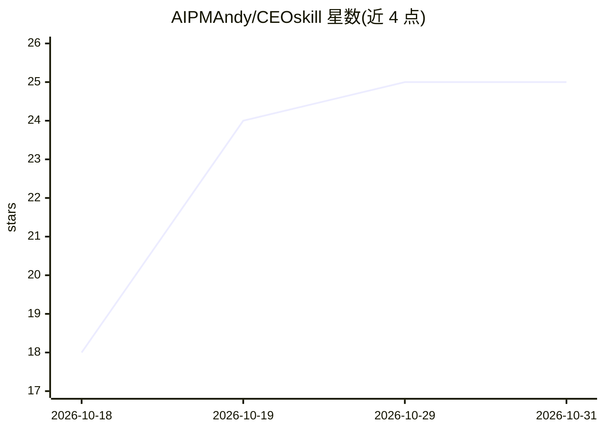

# AIPMAndy/CEOskill

⭐ 25 · Python · MIT · 推送 2026-06-18 · [GitHub](https://github.com/AIPMAndy/CEOskill) · 个人维护 · 中文 README

**供 AI Agent 调用的 CEO 级决策分析技能包**

以 SKILL.md 为核心的 Agent Skill 包，安装到 OpenClaw/Claude Code/Cursor 等 Agent 运行时后，使 Agent 以结构化流程处理高管决策问题：决策分类（One-Way/Two-Way Door 等）、强制生成至少 3 个可比选项并做 trade-off 分析、认知偏差检查（锚定/沉没成本/确认偏差/FOMO 等）、竞争推演、利益相关者映射与贝叶斯决策分析。附 references 参考文档与 Python 分析脚本（Monte Carlo/ICE/NPV）。基本版仅需文本能力，部分示例标注待补充。

## 筛选速览

| 维度 | 判定 | 备注 |
|---|---|---|
| AI 角色 | `ai-ecosystem` | LLM/agent 周边工具 |
| 许可风险 | `permissive` | MIT |
| 部署形态 | `None` |  |
| 模型依赖 | — | README 未给出锁定关系 |
| 硬件要求 | — | 无带数字的原话,不猜 |
| 安装摩擦 | `low` | 无编译、无系统依赖或容器化 |
| 成熟度 | — | 结构信号不足 |

## 能力要点

- 决策分类 + 框架选择 + 强制 3 选项 + trade-off 分析的结构化流程
- 认知偏差检查与竞争推演（war gaming）模块
- 贝叶斯决策分析：A-E 证据分级、似然比更新、敏感性分析
- Python 分析脚本：Monte Carlo / ICE / NPV / IRR / 期望值

## 适用场景

- 让 Agent 拆解战略决策：进新市场、收购还是自建、止损与否
- 多项目资源分配与优先级排序的量化分析
- 危机响应与利益相关方（董事会/投资人/管理层）对齐分析
- 预测竞对对自己降价、上新或收购动作的反应

## 场景标签

`提示工程` · 领域:Agent 开发

## 证据(README 行号)

> L3: **AI 决策助手，专为高管设计。不只给建议，更会拆解 trade-off、识别认知偏差、预判竞争反应。**
> L261: ├── SKILL.md                            # 主 skill 定义（核心）

## 星数曲线

2026-10-18 18 → 2026-10-31 25（+7）

---
*卡片 v1 · prompt 1.4 · 生成 2026-10-27 · 置信度 high · 依据 README sha `90055c98e2a9` · [字段定义](../../DATASET.md)*
