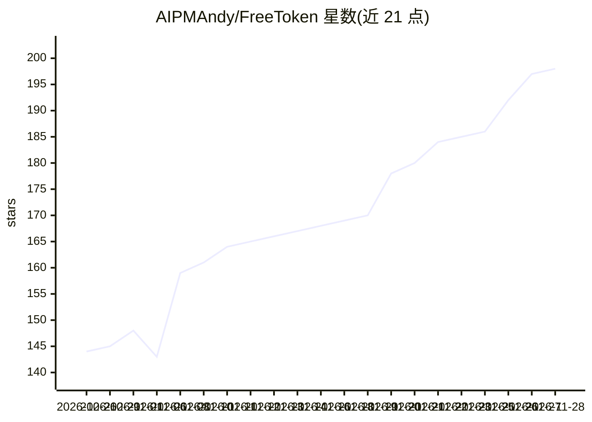

# AIPMAndy/FreeToken

⭐ 198 · HTML · MIT · 推送 2026-11-27 · [GitHub](https://github.com/AIPMAndy/FreeToken) · [官网](https://aipmandy.github.io/FreeToken/) · 个人维护 · 中文 README

**中文开发者的免费 AI API 额度申请导航清单**

以清单形式整理各 LLM 平台的免费 API 额度获取信息：每条记录免费资格、申请入口、官方来源、限制和核验日期，区分官方免费层、试用额度与待核验状态，并附常见误解澄清、安全提示与平台选择表。数据保存在结构化 providers.json 台账，由 verify.py 脚本自动检查台账与文档一致性。MIT 许可，提供 GitHub Pages 在线阅读站点与 llms.txt 机器可读摘要，不分发共享 API Key。

## 筛选速览

| 维度 | 判定 | 备注 |
|---|---|---|
| AI 角色 | `ai-knowledge` | 知识聚合/清单类 |
| 许可风险 | `permissive` | MIT |
| 部署形态 | `None` |  |
| 模型依赖 | — | README 未给出锁定关系 |
| 硬件要求 | — | 无带数字的原话,不猜 |
| 安装摩擦 | `low` | 无编译、无系统依赖或容器化 |
| 成熟度 | — | 结构信号不足 |

## 能力要点

- 免费 API 资源总表附官方来源与核验日期，区分已核验与待核验条目
- data/providers.json 结构化台账加 scripts/verify.py 自动一致性检查
- 定期复核并撤回过期或不实的免费额度宣传
- 提供 OpenRouter curl 调用示例与平台选择对照表

## 适用场景

- 想低成本调用大模型 API 的开发者找免费额度入口
- 核对某平台免费政策是否仍在生效
- 避免从非官方渠道购买共享 API Key

## 场景标签

`精选清单` · 领域:学习与行业

## 证据(README 行号)

> L1: # 🎁 FreeToken｜免费 AI API Token 获取指南（2026）
> L41: |平台|类型|当前公开政策 / 注意|来源|审核状态|
> L145: - data/providers.json 是结构化资源台账，保存分类、官方文档、核验范围和日期。

## 星数曲线

2026-10-26 144 → 2026-11-28 198（+54）

---
*卡片 v1 · prompt 1.4 · 生成 2026-11-28 · 置信度 high · 依据 README sha `18ffd4817274` · [字段定义](../../DATASET.md)*
