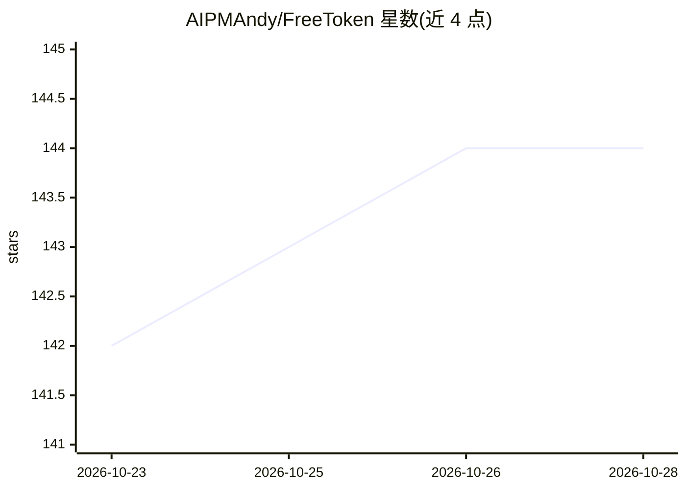

# AIPMAndy/FreeToken

⭐ 145 · HTML · MIT · 推送 2026-10-22 · [GitHub](https://github.com/AIPMAndy/FreeToken) · 个人维护 · 中文 README

**面向中文开发者的免费 AI API 额度导航清单**

收集 Gemini、OpenRouter、Groq、Cloudflare、硅基流动、阿里云百炼等平台免费 API 额度的信息清单：每条记录免费资格、申请入口、限制、核验日期与审核状态（官方已核对/待核验），并列出常见误解澄清与安全注意事项。配套 data/providers.json 结构化台账、scripts/verify.py 一致性自动检查与零追踪静态查询网站。声明不销售、不托管、不代领任何 API Key，MIT 许可。

## 筛选速览

| 维度 | 判定 | 备注 |
|---|---|---|
| AI 角色 | `ai-knowledge` | 知识聚合/清单类 |
| 许可风险 | `permissive` | MIT |
| 部署形态 | `None` |  |
| 模型依赖 | — | README 未给出锁定关系 |
| 硬件要求 | — | 无带数字的原话,不猜 |
| 安装摩擦 | `low` | 无编译、无系统依赖或容器化 |
| 成熟度 | — | 结构信号不足 |

## 能力要点

- 按平台记录免费政策、限制、来源与核验日期的资源总表
- providers.json 台账 + verify.py 自动检查台账/README/网站一致性
- 列出十余条免费额度常见误解的澄清条目
- 配套零追踪静态搜索网站与对抗式审查报告 AUDIT.md

## 适用场景

- 查找当前哪些大模型平台提供官方免费 API 层
- 核对特定平台免费额度的限制条件与有效期
- 了解免费 API 常见误解与 Key 安全实践

## 场景标签

`精选清单` · 领域:学习与行业

## 证据(README 行号)

> L7: 收集 **Gemini、OpenRouter、Groq、Cloudflare Workers AI、Hugging Face、Cohere、DeepSeek、Qwen、智谱 GLM、NVIDIA、硅基流动** 等平台的 AI API
> L105: - data/providers.json 是结构化资源台账，保存分类、官方文档、核验范围和日期。
> L106: - scripts/verify.py 自动检查台账、README、HTML 卡片、网站地图及过期宣传用语的一致性。

## 星数曲线

2026-10-23 142 → 2026-10-28 144（+2）

---
*卡片 v1 · prompt 1.4 · 生成 2026-10-23 · 置信度 high · 依据 README sha `cd0b9f778daa` · [字段定义](../../DATASET.md)*
