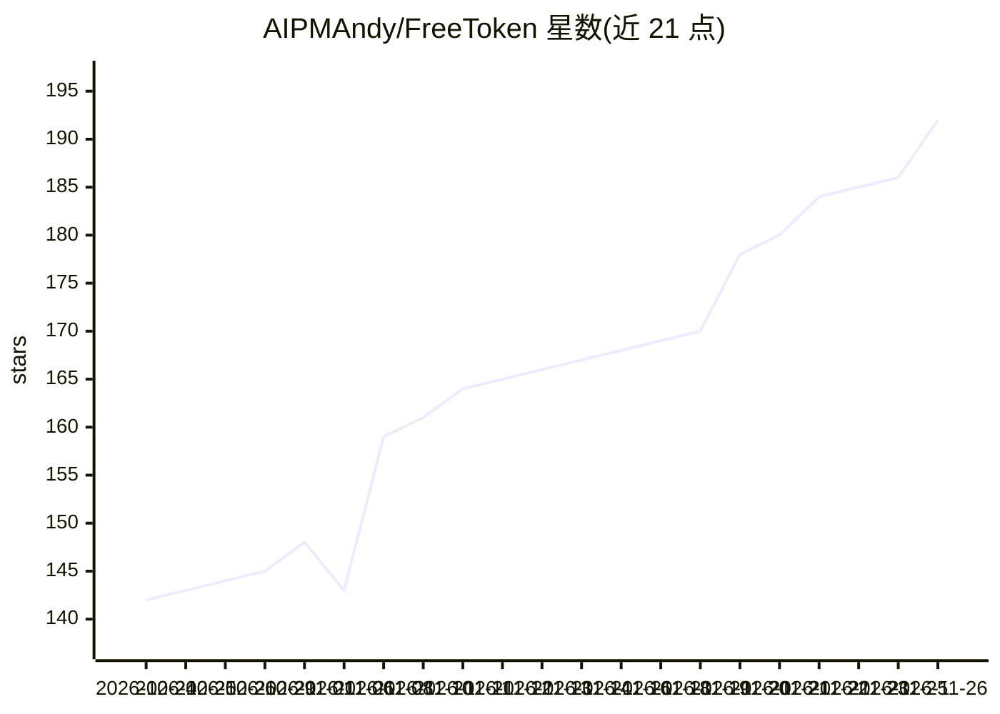

# AIPMAndy/FreeToken

⭐ 192 · HTML · MIT · 推送 2026-11-19 · [GitHub](https://github.com/AIPMAndy/FreeToken) · [官网](https://aipmandy.github.io/FreeToken/) · 个人维护 · 中文 README

**面向中文开发者的免费 AI API 额度申请导航清单**

整理 Gemini、OpenRouter、Groq、Cloudflare Workers AI、硅基流动等平台免费层与试用额度的资源清单，每条附申请入口、限制、官方来源与核验日期，并区分「官方免费层」「试用额度」「待核验」状态。维护者声明只核对公开文档、不实测账号额度、不分发共享 API Key。附带 OpenRouter curl 调用示例、常见误解澄清与安全成本注意事项，数据以 providers.json 台账与自动核验脚本维护。

## 筛选速览

| 维度 | 判定 | 备注 |
|---|---|---|
| AI 角色 | `ai-knowledge` | 知识聚合/清单类 |
| 许可风险 | `permissive` | MIT |
| 部署形态 | `None` |  |
| 模型依赖 | — | README 未给出锁定关系 |
| 硬件要求 | — | 无带数字的原话,不猜 |
| 安装摩擦 | `low` | 无编译、无系统依赖或容器化 |
| 成熟度 | — | 结构信号不足 |

## 能力要点

- 免费 API 平台资源总表，每条附官方来源与核验日期
- 区分官方免费层、试用额度、待核验三类状态，过期宣传撤回
- data/providers.json 结构化台账 + scripts/verify.py 自动一致性检查
- 附 OpenRouter curl 调用示例与额度安全注意事项

## 适用场景

- 想低成本调用大模型的开发者寻找官方免费额度入口
- 按低延迟推理、边缘 AI、国内模型等目标筛选平台
- 核对某平台免费政策的现行状态与限制条件

## 场景标签

`精选清单` · 领域:学习与行业

## 证据(README 行号)

> L5: **面向中文开发者的免费 AI API 额度导航，整理 Gemini、OpenRouter、Groq、DeepSeek、硅基流动等平台的申请入口、限制和核验日期。**
> L30: |平台|类型|当前公开政策 / 注意|来源|审核状态|
> L51: > 数据解释：**官方免费层**＝官方公布的指定 API / 模型免费层；**试用**＝限额体验金或测试密钥；**按模型区分**＝有免费模型也有付费模型；**待复核**＝不能在缺乏现行公开证据时声称免费。详细的领取步骤、限制和搜索

## 星数曲线

2026-10-24 142 → 2026-11-26 192（+50）

---
*卡片 v1 · prompt 1.4 · 生成 2026-11-26 · 置信度 high · 依据 README sha `a89d6e469ebb` · [字段定义](../../DATASET.md)*
