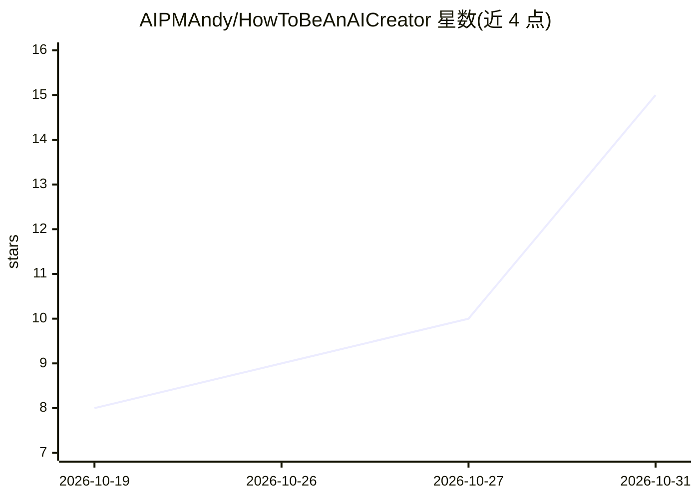

# AIPMAndy/HowToBeAnAICreator

⭐ 15 · Python · MIT · 推送 2026-10-29 · [GitHub](https://github.com/AIPMAndy/HowToBeAnAICreator) · [官网](https://aipmandy.github.io/HowToBeAnAICreator/) · 个人维护 · 中文 README

**AI 博主实操手册：59 张操作卡教新手起号到接商单**

由作者“AI 酋长 Andy”编写的中文开源教程手册：以 59 条操作卡、10 个章节组织从账号定位、选题、AI 产品实测、录屏制作、发布复盘到商单合作的全流程，配 30 天网页打卡与进度导入导出、离线单文件 HTML、Prompt 模板与数据复盘表，并附让 Codex / Claude Code 按手册协作的 AI Skill。操作卡由 data/cards.json 统一维护，经 python tools/build.py 生成网页、Markdown 与离线版本。文字 CC BY 4.0、代码 MIT。

## 筛选速览

| 维度 | 判定 | 备注 |
|---|---|---|
| AI 角色 | `ai-knowledge` | 知识聚合/清单类 |
| 许可风险 | `permissive` | MIT |
| 部署形态 | `None` |  |
| 模型依赖 | — | README 未给出锁定关系 |
| 硬件要求 | — | 无带数字的原话,不猜 |
| 安装摩擦 | `low` | 无编译、无系统依赖或容器化 |
| 成熟度 | — | 结构信号不足 |

## 能力要点

- 59 条操作卡 + 10 章节 + 30 天网页打卡的教程体系
- 离线单文件 HTML 支持搜索与进度勾选，进度存于浏览器本地
- 操作卡数据（cards.json）经 build.py 统一生成并提供一致性测试
- 附对抗式审查报告与 Codex / Claude Code 协作 Skill

## 适用场景

- 零基础新手跟着操作卡做出第一条 AI 实测视频
- 按 30 天打卡计划系统化执行内容日更
- 复用选题评分卡、复盘模板与合作台账模板

## 场景标签

`教程课程` · 领域:学习与行业

## 证据(README 行号)

> L16: > **TL;DR｜一句话**：这是 AI 酋长 Andy 写的免费开源 AI 博主实操手册。适合零基础自媒体新手、AI 工具爱好者和想从 AI+行业打造个人 IP 的人。它从选题、AI 产品实测、录屏、发布、复盘讲到商单合作，含
> L74: 所有操作卡都通过 `data/cards.json` 统一维护，避免网页与 Markdown 内容不同步。针对常见的关键步骤，我们额外给出实际填写示例和“卡住时”的处理方法；网站还有 **30 天打卡、进度导入/导出、离线完整案例

## 星数曲线

2026-10-19 8 → 2026-10-31 15（+7）

---
*卡片 v1 · prompt 1.4 · 生成 2026-10-31 · 置信度 high · 依据 README sha `17537341e6f5` · [字段定义](../../DATASET.md)*
