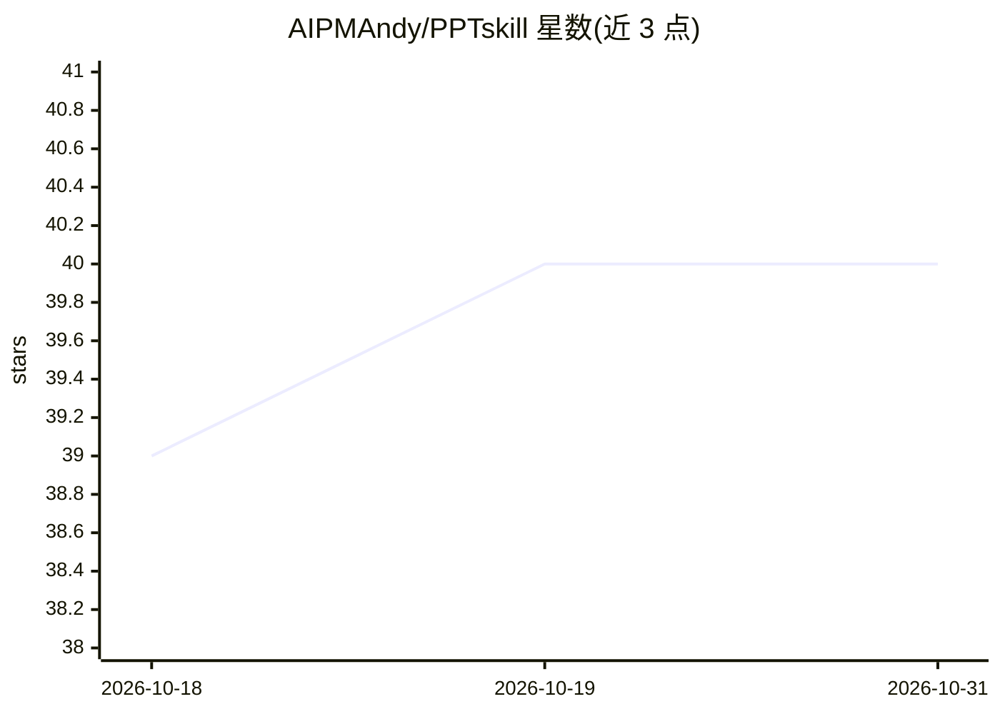

# AIPMAndy/PPTskill

⭐ 40 · Python · MIT · 推送 2026-10-29 · [GitHub](https://github.com/AIPMAndy/PPTskill) · 个人维护 · 中文 README

**基于 ppt-master 的 AI 生成原生可编辑 PPTX 技能工具**

hugohe3/ppt-master 的分支，通过 AI 编辑器（Claude Code、Cursor、OpenClaw 等）从 PDF/DOCX/URL/Markdown 等输入生成原生 DrawingML 对象的可编辑 PPTX 文件，输出为真实 PowerPoint 形状而非图片嵌入。提供 10+ 专业模板、演讲者备注生成与 SVG 导出，附带 15 个示例项目（229 页）。以 Python 脚本仓库形式提供，需 Python 3.9+（推荐 3.9/3.10），可选安装 Node.js 与 Pandoc，可克隆到 OpenClaw 工作区或复制为 Claude Code Skill 使用。

## 筛选速览

| 维度 | 判定 | 备注 |
|---|---|---|
| AI 角色 | `ai-native` | 本体是模型或模型工具 |
| 许可风险 | `permissive` | MIT |
| 部署形态 | `None` |  |
| 模型依赖 | — | README 未给出锁定关系 |
| 硬件要求 | — | 无带数字的原话,不猜 |
| 安装摩擦 | `low` | 无编译、无系统依赖或容器化 |
| 成熟度 | — | 结构信号不足 |

## 能力要点

- 输出原生 DrawingML 形状的可编辑 PPTX，非图片/SVG 嵌入
- 支持 PDF/DOCX/URL/Markdown 多种输入格式
- 10+ 专业模板（咨询风、学术风、禅意风等）
- 支持 OpenClaw 与 Claude Code Skill 两种集成方式

## 适用场景

- 让 AI 编辑器把季度报告或论文生成演示文稿
- 论文答辩、学术汇报场景套用学术风模板
- 在 OpenClaw/Claude Code 工作流中直接对话生成 PPT

## 场景标签

 · 领域:文档生成/办公自动化

## 证据(README 行号)

> L3: **AI 生成原生可编辑 PPTX — 无需设计技能，一键生成专业演示文稿**
> L25: **核心差异**：输出的是**真正的 PowerPoint 对象**（DrawingML），不是图片或 SVG 嵌入。点击任何元素都可以直接编辑。
> L200: 1. 将本仓库克隆到 OpenClaw 工作区

## 星数曲线

2026-10-18 39 → 2026-10-31 40（+1）

---
*卡片 v1 · prompt 1.4 · 生成 2026-10-25 · 置信度 high · 依据 README sha `e8ac015cf9ab` · [字段定义](../../DATASET.md)*
