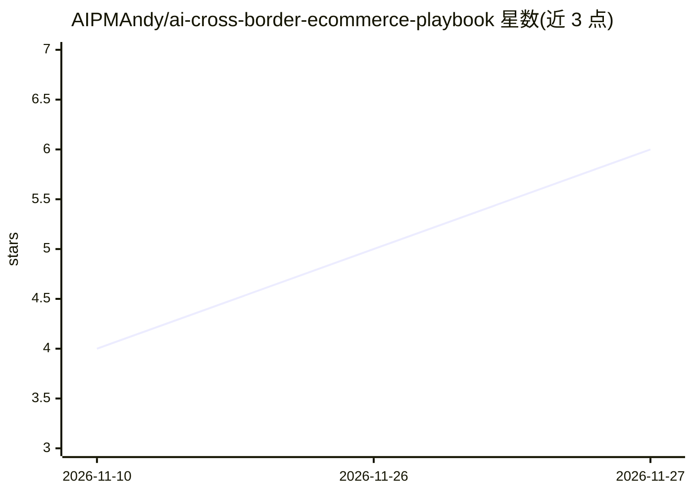

# AIPMAndy/ai-cross-border-ecommerce-playbook

⭐ 6 · HTML · MIT · 推送 2026-11-20 · [GitHub](https://github.com/AIPMAndy/ai-cross-border-ecommerce-playbook) · [官网](https://aipmandy.github.io/ai-cross-border-ecommerce-playbook/) · 个人维护

**面向零基础者的 AI 跨境电商开源实战手册（24 章/96 卡）**

免费开源的跨境电商教程与互动网站：24 章、96 张操作卡、25 个可追溯案例、12 份深度手册、16 套提示词，覆盖定位资格、需求选品、供应商、支付物流、AI 内容生成、获客与运营，附路线诊断、利润/现金计算器、压力测试与 30 天逐日计划。提供 GitHub Pages 静态网站与离线单文件版，无需 Node、后端或付费 API，用 Python 脚本构建内容；进度数据保存在浏览器本地，支持 JSON 导入导出。

## 筛选速览

| 维度 | 判定 | 备注 |
|---|---|---|
| AI 角色 | `ai-knowledge` | 知识聚合/清单类 |
| 许可风险 | `permissive` | MIT |
| 部署形态 | `None` |  |
| 模型依赖 | — | README 未给出锁定关系 |
| 硬件要求 | — | 无带数字的原话,不猜 |
| 安装摩擦 | `low` | 无编译、无系统依赖或容器化 |
| 成熟度 | — | 结构信号不足 |

## 能力要点

- 96 张操作卡含目标、操作、验收与卡住处理，附深度实操入口
- 25 个案例带原始 URL、数据边界与核对日的证据账本
- 利润、现金与压力测试计算器及 Python 可复算模型（unit_economics.py）
- offline.html 单文件离线版，含完整搜索、计算与打卡功能

## 适用场景

- 按 30 天计划逐日推进跨境电商从选品到第一单
- 用计算器评估单笔贡献、可承受 CAC 与首批现金占用
- 查找带原始来源的 AI 跨境电商真实案例与失败复盘

## 场景标签

`教程课程` · 领域:学习与行业

## 证据(README 行号)

> L5: **从目标市场、真实需求、选品、供应商、收款、物流，到 AI 内容、第一笔订单与长期利润的免费开源教程。**
> L9: **V2.0｜24 章 · 96 张操作卡 · 25 个可追溯案例 · 12 份深度手把手教程 · 30 天实战 · 路线诊断 · 利润/现金/压力测试 · 16 套提示词**
> L121: - **离线文件**：`offline.html`内含CSS、JavaScript与全部数据；下载单文件后双击可以用完整搜索、计算、打卡。外部证据链接和其他仓库文档需要联网或拥有完整文件夹。

## 星数曲线

2026-11-10 4 → 2026-11-27 6（+2）

---
*卡片 v1 · prompt 1.4 · 生成 2026-11-21 · 置信度 high · 依据 README sha `810bdef9cd20` · [字段定义](../../DATASET.md)*
