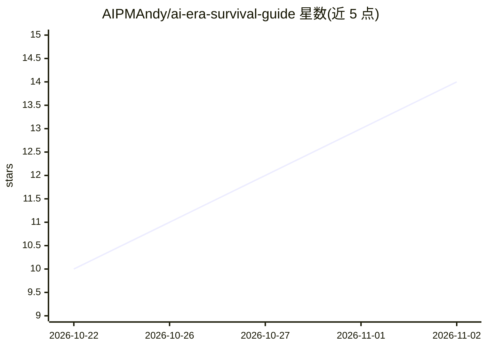

# AIPMAndy/ai-era-survival-guide

⭐ 14 · HTML · MIT · 推送 2026-10-29 · [GitHub](https://github.com/AIPMAndy/ai-era-survival-guide) · [官网](https://aipmandy.github.io/ai-era-survival-guide/) · 个人维护 · 中文 README

**中国职场 AI 时代生存攻略：岗位 AI 用法与第二收入路径**

个人作者（AI 酋长 Andy，前腾讯/百度 AI 产品人士）撰写并开源的中文职业攻略文档：对中国职场 2027—2029 年变化给出条件性判断，覆盖 30 种常见岗位的 AI 用法与职责升级方向，分别给出在职、失业、应届、跳槽和管理者的应对建议，以及在主业基础上发展第二收入的路径。以网站与 Markdown 全文形式免费提供，并保留六册研究资料、岗位实操卡、9 张信息图与互动工具；作者声明趋势判断为个人条件判断，来源集中于文档末尾与 docs/SOURCES.md。不含可安装的软件。

## 筛选速览

| 维度 | 判定 | 备注 |
|---|---|---|
| AI 角色 | `ai-knowledge` | 知识聚合/清单类 |
| 许可风险 | `permissive` | MIT |
| 部署形态 | `None` |  |
| 模型依赖 | — | README 未给出锁定关系 |
| 硬件要求 | — | 无带数字的原话,不猜 |
| 安装摩擦 | `low` | 无编译、无系统依赖或容器化 |
| 成熟度 | — | 结构信号不足 |

## 能力要点

- 30 种常见岗位的 AI 用法与升级方向
- 2027—2029 三年职业变化的作者条件判断
- 在职/失业/应届/跳槽/管理者分处境应对建议
- 附六册研究资料、岗位实操卡与 9 张矢量信息图

## 适用场景

- 想了解自己岗位如何用 AI 的职场人按岗查找建议
- 失业或跳槽期寻找应对路径与求职参考
- 在主业基础上探索第二收入路径
- 查看政策、招聘数据等来源做独立判断

## 场景标签

`教程课程` · 领域:学习与行业

## 证据(README 行号)

> L7: **AI 时代普通人怎么不被淘汰？** 这是 AI 酋长 Andy 对中国职场 2027—2029 年的判断和应对攻略：30 种常见岗位的 AI 用法，在职、失业、应届、跳槽和管理者分别怎样应对，以及在主业基础上发展第二收入的路径。
> L15: > **TL;DR｜一句话**：这是 AI 酋长 Andy 对中国职场 2027—2029 年的判断与应对攻略。适合在职、失业、应届、跳槽者和管理者。它给出 30 种常见岗位的 AI 用法、不同处境的应对方法，以及在主业基础上发展
> L27: - 中国招聘市场、政策和企业为什么开始重新分配工作

## 星数曲线

2026-10-22 10 → 2026-11-02 14（+4）

---
*卡片 v1 · prompt 1.4 · 生成 2026-10-31 · 置信度 high · 依据 README sha `05fb95ad5866` · [字段定义](../../DATASET.md)*
