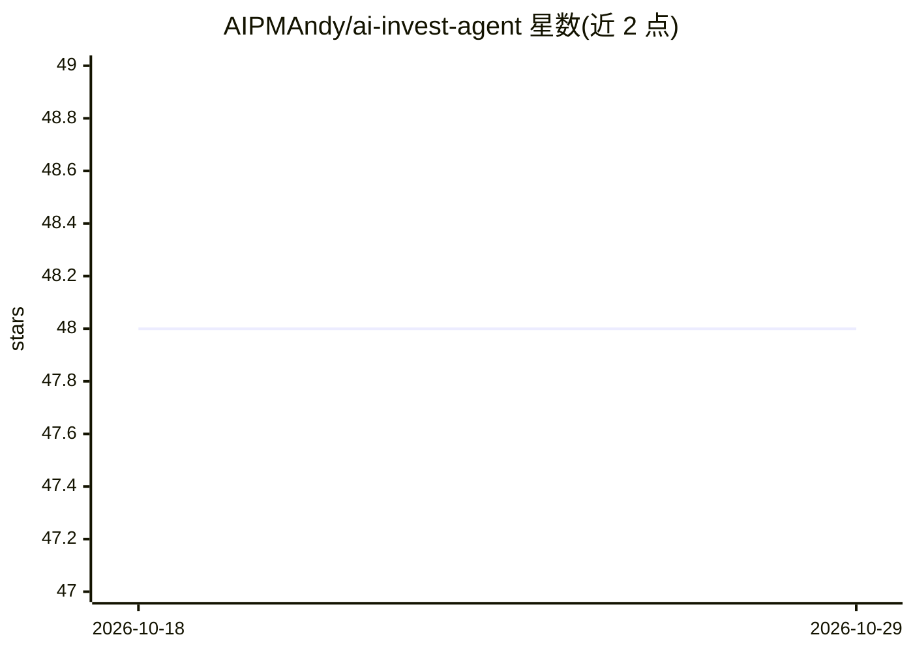

# AIPMAndy/ai-invest-agent

⭐ 48 · Python · Apache-2.0 · 推送 2026-10-22 · [GitHub](https://github.com/AIPMAndy/ai-invest-agent) · [官网](https://github.com/AIPMAndy) · 个人维护 · 中文 README

**AI 投资复盘工具：记录交易并用 AI 分析决策与风险**

以 CLI 和 Python 库形式提供的投资记录与 AI 复盘工具：支持记录 A股/港股/美股买卖交易并自动同步持仓成本、追溯历史，AI Agent 模块（含个股分析等）产出收益归因、胜率统计与风险评估，并提供止盈止损、财报发布预警和仓位管理建议。作者为个人开发者（前腾讯/百度 AI 产品背景），README 附其咨询服务与其他项目推广。pip 安装，Apache 2.0 许可。

## 筛选速览

| 维度 | 判定 | 备注 |
|---|---|---|
| AI 角色 | `ai-native` | 本体是模型或模型工具 |
| 许可风险 | `permissive` | Apache-2.0 |
| 部署形态 | `library` | 以包/库形式分发 |
| 模型依赖 | — | README 未给出锁定关系 |
| 硬件要求 | — | 无带数字的原话,不猜 |
| 安装摩擦 | `low` | 无编译、无系统依赖或容器化 |
| 成熟度 | — | 结构信号不足 |

## 能力要点

- 交易记录与持仓成本自动同步，支持 A股/港股/美股
- AI 复盘分析：收益归因、胜率统计、风险评估
- 止盈止损提醒、财报发布预警、仓位管理建议
- CLI 与 Python Agent API 两种使用方式

## 适用场景

- 我想系统记录并复盘自己的股票买卖决策
- 让 AI 帮我分析收益来源和胜率
- 需要止盈止损和财报时点的提醒

## 场景标签

`金融量化` · 领域:学习与行业

## 证据(README 行号)

> L5: > AI 投资复盘系统 - 让 AI 像专业投资人一样复盘你的投资决策
> L39: - 收益归因分析

## 星数曲线

2026-10-18 48 → 2026-10-29 48（+0）

---
*卡片 v1 · prompt 1.4 · 生成 2026-10-25 · 置信度 mid · 依据 README sha `64175140c1e5` · [字段定义](../../DATASET.md)*
