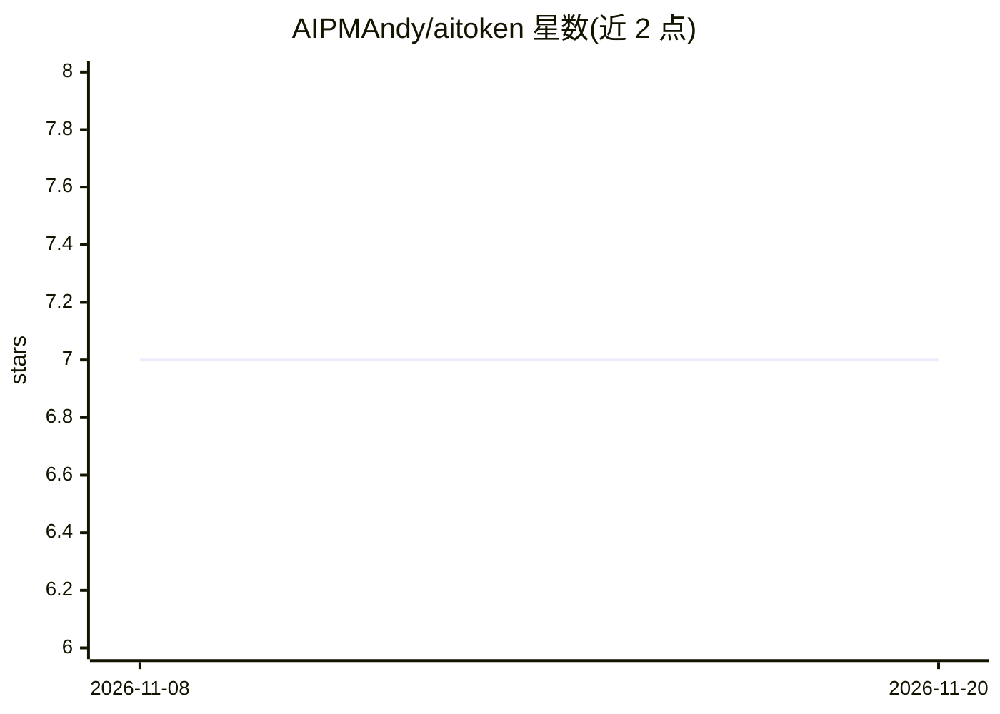

# AIPMAndy/aitoken

⭐ 7 · MIT · 推送 2026-11-12 · [GitHub](https://github.com/AIPMAndy/aitoken) · [官网](https://kb.metaver.vip/aitoken) · 个人维护 · 中文 README

**海外 AI 服务、账号订阅与 Token 供应的个人实测笔记**

以文档仓库形式记录作者对 20+ 个海外 AI 平台的可用性、价格、订阅渠道与网络环境配置的实测过程，覆盖 GPT/Codex、Claude、Grok、Gemini 及国产模型的账号获取、中转 API 使用、封号风险与防诈提醒。内容为个人测试笔记，含推广返佣链接声明，不提供账号、充值或技术支持，作者声明不构成采购或合规建议。

## 筛选速览

| 维度 | 判定 | 备注 |
|---|---|---|
| AI 角色 | `ai-knowledge` | 知识聚合/清单类 |
| 许可风险 | `permissive` | MIT |
| 部署形态 | `None` |  |
| 模型依赖 | — | README 未给出锁定关系 |
| 硬件要求 | — | 无带数字的原话,不猜 |
| 安装摩擦 | `low` | 无编译、无系统依赖或容器化 |
| 成熟度 | — | 结构信号不足 |

## 能力要点

- 覆盖 20+ 平台的可用性与价格实测记录
- 记录账号订阅、中转 API 与网络环境的踩坑过程
- 包含防诈提醒与推广返佣关系声明
- 附原始知识库页面链接与免费额度开源项目

## 适用场景

- 了解各海外 AI 服务的订阅渠道与价格区间
- 参考中转 API 使用中的风控与封号经验
- 查阅获取免费 Token 额度的途径

## 场景标签

 · 领域:AI 服务评测/经验记录

## 证据(README 行号)

> L3: > 一份关于海外 AI 服务、账号订阅、网络环境和 Token 供应的个人实测记录。
> L11: 用个海外 AI 真 TM 不容易，最近我搞完各种网络问题，测了 20+ 个平台。先记一版当前进度，后面继续更新。
> L85: **海外 AI 服务、账号订阅、网络环境与 Token 供应的个人实测记录，仅为测试笔记，不构成采购或合规建议。**

## 星数曲线

2026-11-08 7 → 2026-11-20 7（+0）

---
*卡片 v1 · prompt 1.4 · 生成 2026-11-20 · 置信度 high · 依据 README sha `ff8f503f96ae` · [字段定义](../../DATASET.md)*
