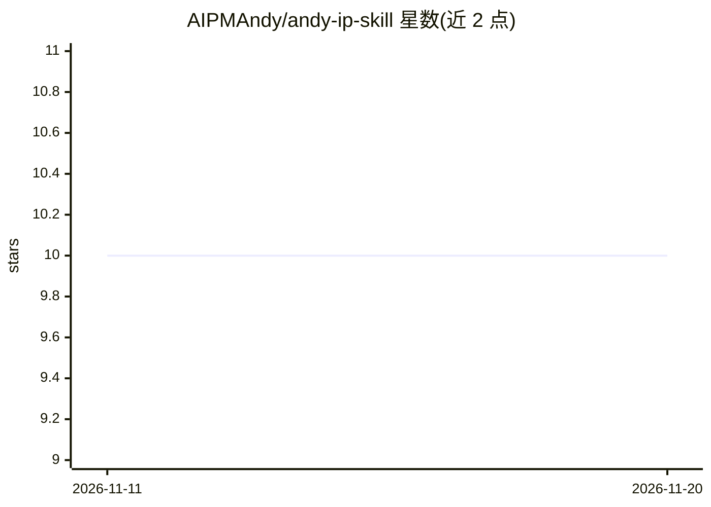

# AIPMAndy/andy-ip-skill

⭐ 10 · Shell · MIT · 推送 2026-10-25 · [GitHub](https://github.com/AIPMAndy/andy-ip-skill) · 个人维护 · 中文 README

**面向个人IP打造者的AI内容创作技能工具箱**

以Claude Code Skills形式组织的个人IP增长工具集合，按基础设施、内容创作、内容发布、数据研究、开发工具五层组织，包含dna-memory长期记忆系统、Copyflow一键多风格生成、公众号/白皮书/PPT/视频脚本创作、多平台合规检查、飞书协作等技能，并提供智能路由入口按需求匹配工具。通过git clone克隆到~/.claude/skills目录安装，飞书工具需自行配置API凭证；各子项目遵循各自的开源协议。

## 筛选速览

| 维度 | 判定 | 备注 |
|---|---|---|
| AI 角色 | `ai-native` | 本体是模型或模型工具 |
| 许可风险 | `permissive` | MIT |
| 部署形态 | `None` |  |
| 模型依赖 | — | README 未给出锁定关系 |
| 硬件要求 | — | 无带数字的原话,不猜 |
| 安装摩擦 | `low` | 无编译、无系统依赖或容器化 |
| 成熟度 | — | 结构信号不足 |

## 能力要点

- 五层架构组织150+本地Skills与25+开源仓库
- 智能路由入口按需求自动匹配工具
- DNA Memory跨会话记忆与创作洞察记录
- Copyflow单选题生成10种风格内容

## 适用场景

- 批量生成公众号、小红书、抖音等多平台内容
- 创作白皮书并生成PDF排版
- 追踪海外Builder动态获取AI领域情报
- 为个人IP搭建网站并部署到GitHub Pages

## 场景标签

`AI 写作` `AI 助手` · 领域:对话与助手

## 证据(README 行号)

> L17: Andy IP Skill Stack 是一个**完整的个人IP增长AI工作流生态系统**：
> L26: - **爆款方法论**：对抗式生成 + Andy风格DNA + 多平台合规检查
> L257: - **内容创作者** - 公众号作者、博主、自媒体人

## 星数曲线

2026-11-11 10 → 2026-11-20 10（+0）

---
*卡片 v1 · prompt 1.4 · 生成 2026-11-20 · 置信度 high · 依据 README sha `7259be83cfef` · [字段定义](../../DATASET.md)*
